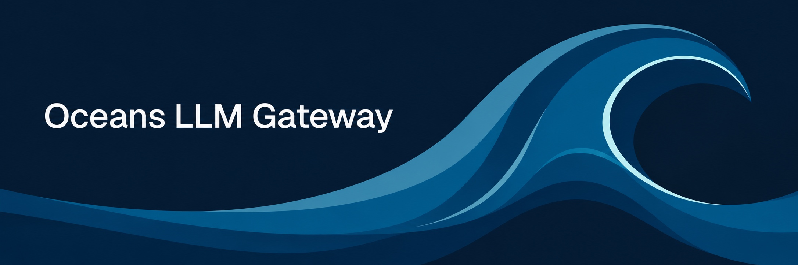

# Oceans LLM Gateway

<p align="center">

</p>

Rust-first LLM gateway workspace with an embedded TanStack Start admin control plane.

## Overview

- `crates/gateway`
  - Rust HTTP runtime for `/healthz`, `/readyz`, `/v1/*`, and `/api/v1/admin/*`
- `crates/gateway-core`
  - shared domain types, traits, OpenAI-compatible Chat/Responses/Embeddings DTOs, and errors
- `crates/gateway-mcp`
  - protocol-only MCP JSON-RPC, Streamable HTTP discovery, tool normalization, and schema hashing
- `crates/gateway-store`
  - libsql or SQLite and PostgreSQL stores, migrations, and seed behavior
- `crates/gateway-service`
  - auth, model resolution, routing, accounting, and request logging
- `crates/gateway-providers`
  - provider adapters and transport helpers
- `crates/admin-ui`
  - Rust reverse-proxy integration for `/admin*`
- `crates/admin-ui/web`
  - TanStack Start and React admin UI

| If you want to... | Start here |
| --- | --- |
| Understand the product and its capabilities | [Features](https://oceans-llm.com/features/) |
| Run Oceans LLM for the first time | [Introduction](https://oceans-llm.com/introduction/) |
| Choose between local, Compose, and Kubernetes deployments | [Topology and operations](https://oceans-llm.com/setup/deploy-and-operations/) |
| Understand startup, seeded state, and first access | [Start up and first access](https://oceans-llm.com/setup/first-access/) |
| Configure providers, models, authentication, and runtime behavior | [Configuration Reference](https://oceans-llm.com/configuration/) |
| Understand routing and supported API families | [Model Routing and APIs](https://oceans-llm.com/configuration/model-routing/) and [Provider API Compatibility](https://oceans-llm.com/reference/provider-api-compatibility/) |
| Configure identities, service accounts, API keys, or budgets | [Identity and Access](https://oceans-llm.com/access/identity-and-access/), [Service Accounts](https://oceans-llm.com/access/service-accounts/), and [Budgets](https://oceans-llm.com/spend/budgets/) |
| Register MCP servers and control tool access | [MCP Servers](https://oceans-llm.com/extensions/mcp-servers/), [MCP Tool Access](https://oceans-llm.com/extensions/mcp-tool-access/), and [MCP Client Setup](https://oceans-llm.com/extensions/mcp-client-setup/) |
| Enable and operate gateway guardrails | [Gateway Guardrails](https://oceans-llm.com/operations/gateway-guardrails/) |
| Configure telemetry or inspect request logs | [Observability and Request Logs](https://oceans-llm.com/observability/) |
| Upgrade a deployment or recover a failure | [Admin Runbooks](https://oceans-llm.com/operations/admin-runbooks/) |
| Contribute to the repository | [Contributing](CONTRIBUTING.md) and [Contributing & Internal](docs/contributing/index.md) |

Install the repo toolchain:

```bash
eval "$(mise activate zsh)"
mise install
mise run //ui:install
```

Run the local development stack:

```bash
mise run dev-stack
```

Default local endpoints:

- gateway API: `http://localhost:8080`
- admin UI: `http://localhost:8080/admin`
- active config: `./gateway.yaml`
- database backend: local libsql or SQLite

`mise run dev-stack` refreshes the local demo dataset on startup and gives platform admins access to calibration data. Sign in with the seeded platform admin and open **Observability → Agent Sessions** to inspect the sample session reports. The demo includes ten-request Jira and repository sessions. The Jira session has six available tools, two direct MCP calls, and file operations. Use `mise run //gateway:reset-local-demo` to recreate the complete sample state.

## Core Commands

- local dev stack:
  - `mise run dev-stack`
- local gateway:
  - `mise run //gateway:serve`
- local explicit migration:
  - `mise run //gateway:migrate`
- local explicit bootstrap admin:
  - `mise run //gateway:bootstrap-admin`
- local explicit config seed:
  - `mise run //gateway:seed-config`
- request-log retention purge:
  - `mise run //gateway:purge-request-logs --dry-run`
  - `mise run //gateway:purge-request-logs`
  - `mise run //gateway:prod:purge-request-logs --dry-run`
  - `mise run //gateway:prod:purge-request-logs`
- local-only demo dataset seed:
  - `mise run //gateway:seed-local-demo`
- local-only demo dataset reset:
  - `mise run //gateway:reset-local-demo`
- production-shaped local stack:
  - `mise run prod-stack`
- production-shaped explicit migration:
  - `mise run //gateway:prod:migrate`
- production-shaped explicit bootstrap admin:
  - `mise run //gateway:prod:bootstrap-admin`
- production-shaped explicit config seed:
  - `mise run //gateway:prod:seed-config`
- admin contract generation:
  - `mise run admin-contract-generate`
- admin contract drift check:
  - `mise run admin-contract-check`
- full lint:
  - `mise run lint`
- full test:
  - `mise run test`
- E2E contract suite:
  - `mise run //ui:e2e`

## Migration Policy

- Fresh databases apply one active `V17` baseline per backend.
- Databases carrying pre-baseline `V1` through `V16` history must be recreated instead of upgraded in place.
- Use `mise run //gateway:migrate` to apply or inspect the active migration state.

## Documentation Map

Use the docs site instead of treating this file as the full admin and maintainer manual.

- repo workflow:
  - [Contributing](CONTRIBUTING.md)
- docs site:
  - [Documentation Home](https://oceans-llm.com/)
- startup and first access:
  - [Start up and first access](https://oceans-llm.com/setup/first-access/)
- config contract:
  - [Configuration Reference](https://oceans-llm.com/configuration/)
- identity:
  - [Identity and Access](https://oceans-llm.com/access/identity-and-access/)
- gateway API keys and service-account-style callers:
  - [Admin Control Plane](https://oceans-llm.com/access/admin-control-plane/)
- budgets:
  - [Budgets](https://oceans-llm.com/spend/budgets/)
- routing:
  - [Model Routing and APIs](https://oceans-llm.com/configuration/model-routing/)
- provider API compatibility:
  - [Provider API Compatibility](https://oceans-llm.com/reference/provider-api-compatibility/)
- provider setup:
  - [Google Cloud Run](https://oceans-llm.com/providers/gcp-cloud-run/)
  - [Google Vertex AI](https://oceans-llm.com/providers/gcp-vertex/)
- cross-cutting request flow:
  - [Request Lifecycle and Failure Modes](https://oceans-llm.com/reference/request-lifecycle/)
- pricing and spend:
  - [Pricing Catalog and Accounting](https://oceans-llm.com/spend/pricing-and-accounting/)
  - [Budgets and Spending](docs/contributing/operations/budgets-and-spending.md)
- observability:
  - [Observability and Request Logs](https://oceans-llm.com/observability/)
  - [MCP Registry and Discovery](docs/contributing/mcp/mcp-registry-and-discovery.md)
- admin UI:
  - [Admin Control Plane](https://oceans-llm.com/access/admin-control-plane/)
- maintainer-facing docs source notes:
  - [Documentation Source Notes](docs/README.md)
- deploy quick start:
  - [Deploy](deploy/README.md)
- Kubernetes and Helm:
  - [Kubernetes and Helm](https://oceans-llm.com/setup/kubernetes-and-helm/)
  - [Helm Chart](deploy/helm/oceans-llm/README.md)
- self-hosting (mise daemons + Tailscale):
  - [Local process (mise)](https://oceans-llm.com/setup/self-hosting/)

## Same-Origin Runtime Model

The product runs as a same-origin control plane:

1. the gateway listens on the configured bind address
2. the admin UI SSR process runs separately
3. the gateway reverse-proxies `/admin*` to the admin UI upstream

This is part of the product contract, not only a local-dev trick.

## Admin Contract Generation

The live admin control plane ships checked-in contract artifacts:

- gateway OpenAPI artifact:
  - `crates/gateway/openapi/admin-api.json`
- generated admin UI types:
  - `crates/admin-ui/web/src/generated/admin-api.ts`

Regenerate them with:

```bash
mise run admin-contract-generate
```

Verify drift with:

```bash
mise run admin-contract-check
```

For the full maintainer workflow, use [Admin API Contract Workflow](docs/contributing/reference/admin-api-contract-workflow.md).
