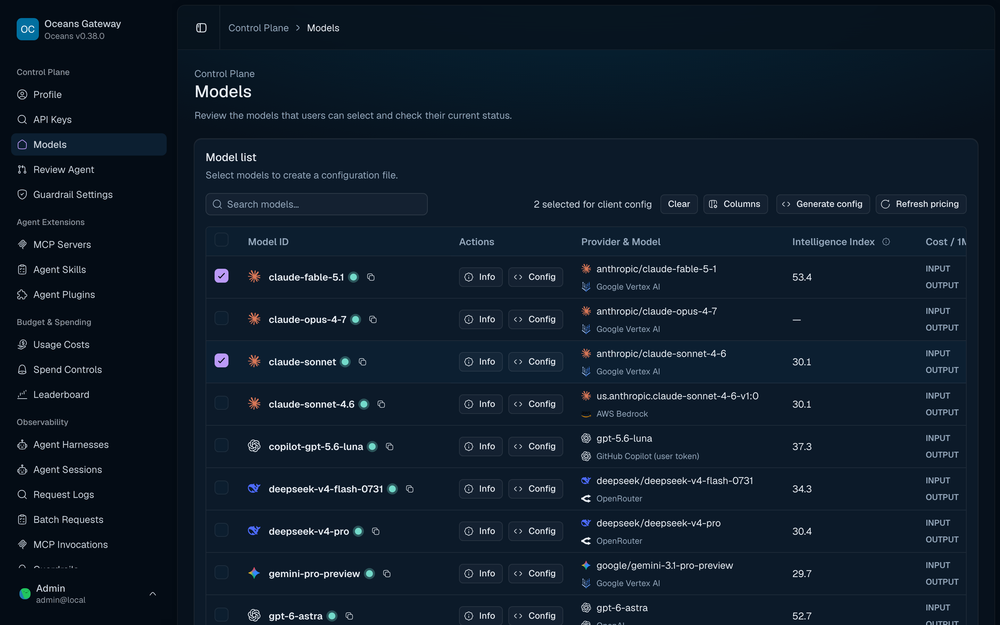

# Configuration Reference

`See also`: [Oceans LLM Gateway](../../README.md), [Runtime Bootstrap and Access](../setup/runtime-bootstrap-and-access.md), [Identity and Access](../access/identity-and-access.md), [Service Accounts](../access/service-accounts.md), [Model Routing and APIs](model-routing-and-api-behavior.md), [Pricing Catalog and Accounting](pricing-catalog-and-accounting.md), [OIDC and SSO](../access/oidc-and-sso-status.md), [ADR: Configurable Admin Page Permissions](../adr/2026-08-05-configurable-admin-page-permissions.md)

This page owns config syntax and parse-time rules. It does not own the full runtime story after a request starts moving.



## Source of Truth

- config parsing and validation:
  - [../crates/gateway/src/config/mod.rs](../../crates/gateway/src/config/mod.rs)
- provider capability defaults:
  - [../crates/gateway-core/src/domain.rs](../../crates/gateway-core/src/domain.rs)
- checked-in examples:
  - [../gateway.yaml](../../gateway.yaml)
  - [../gateway.prod.yaml](../../gateway.prod.yaml)
  - [../deploy/config/gateway.yaml](../../deploy/config/gateway.yaml)

## Top-Level Sections

Unknown fields are rejected at the top level and in models, routes, route `capabilities` and `compatibility`, providers, users, and user memberships. Correct misspelled keys instead of relying on silently ignored values.

- `server`
- `database`
- `auth`
- `permissions`
- `mcp`
- `skills`
- `budgets`
- `budget_alerts`
- `rate_limits`
- `request_logging`
- `agent_analysis`
- `guardrails`
- `providers`
- `models`
- `teams`
- `service_accounts`
- `users`

## Config Files and Fragments

The gateway reads one main file and, optionally, a directory of fragments.

| Flag | Environment variable | Default | When the path is missing |
| --- | --- | --- | --- |
| `--config` | `GATEWAY_CONFIG` | `./gateway.yaml` | Startup fails when the path was set explicitly. Only the implicit default may be absent; the gateway then starts with built-in defaults. |
| `--config-dir` | `GATEWAY_CONFIG_DIR` | none | Startup fails. |

`providers` and `models` accept either a list of entries with `id`, or a map keyed by id. Prefer the map form: Helm merges maps across `-f` values files but replaces lists, and a map cannot repeat an id. A map entry must not also set `id`.

```yaml
providers:
  openai-prod:
    type: openai_compat
    base_url: https://api.openai.com/v1
    auth:
      token: env.OPENAI_API_KEY
models:
  gpt-5.6-luna:
    route:
      provider: openai-prod
      upstream_model: gpt-5.6-luna
```

Fragment rules:

- The gateway reads `*.yaml` and `*.yml` files below `--config-dir` recursively, in lexical order of relative path.
- It skips files and directories whose names start with `.`, which covers the `..data` directories in Kubernetes ConfigMap mounts, and it follows symlinks.
- A symlink must resolve inside `--config-dir`. The loader resolves each file and directory to its real path and fails at startup, naming the link and its target, when that path is outside the directory. It never reads files outside `--config-dir`. Kubernetes ConfigMap mounts link only within the mount, so they pass.
- A main config file inside `--config-dir` is read once, as the main file, not again as a fragment.
- A fragment may contain only `providers` and `models`. Every other section stays in the main file.
- Fragments merge as a union. A provider or model id defined in two places, including the main file, is an error that names both files. No file overrides another.
- References such as `routes[].provider`, `alias_of`, `budgets.users.model_defaults`, and `service_accounts[].keys[].allowed_models` resolve after the merge, so they can point across files.
- Validation runs once on the merged result.

A layout that keeps ownership clear puts each provider account and the models that route only to it in one file, and models whose routes span providers in a shared file:

```text
conf.d/
  models/
    openai.yaml          # openai-prod, openai-secondary, and their single-provider models
    bedrock.yaml
    multi-provider.yaml  # models whose routes use more than one provider file
```

[`deploy/examples/config-dir`](../../deploy/examples/config-dir) is a runnable example. `gateway config render --show-sources` prints the merged `providers` and `models` in map form and lists the file that defined each one. It redacts `literal.` values, header values, and URL credentials (usernames, passwords, query values, and fragments); `env.` and `file.` references stay visible. Redaction covers credentials only: the output still includes identity data such as user emails, team keys, and file paths, so review it before sharing. `gateway config validate` accepts the same flags.

Removing a fragment does not remove what it seeded. Models and providers that disappear from config stay in the database, and their routes stay enabled. Disable a model's routes with `enabled: false` before deleting its entry.

## Value Sources

For `skills` storage fields, upload limits, and AWS S3 or RustFS examples, see [Agent Skills](../setup/skills.md#enable-storage). Skills are disabled by default.

The config supports literal values and env references.

Common patterns:

- `literal.admin`
- `env.OPENAI_API_KEY`
- `env.POSTGRES_URL`

The YAML holds structure. Secrets and deploy-specific values come from the environment by default.

## Minimal Local Example

```yaml
server:
  bind: "127.0.0.1:8080"

database:
  kind: libsql
  path: "./var/oceans.db"

auth:
  bootstrap_admin:
    email: "admin@local"
    password: "literal.admin"
    require_password_change: false

providers:
  openai:
    type: openai_compat
    base_url: "https://api.openai.com/v1"
    auth:
      token: env.OPENAI_API_KEY

models:
  gpt-4o-mini:
    route:
      provider: openai
      upstream_model: gpt-4o-mini
```

## Benchmark catalogue

The admin Models page shows Artificial Analysis Intelligence, Coding, and Agentic indices from a vendored snapshot at `crates/gateway-service/data/model_benchmarks.json`. The gateway makes no benchmark network calls at runtime and needs no API key.

By default, scores are matched from the primary route's `upstream_model`. The gateway normalizes provider-specific forms such as `us.anthropic.claude-sonnet-4-6-v1:0` or `claude-sonnet-4-6@20260101` to OpenRouter IDs such as `anthropic/claude-sonnet-4.6`, and uses only exact matches. Set `benchmark_model_id` to choose the OpenRouter model explicitly:

```yaml
models:
  - id: scored-model
    benchmark_model_id: anthropic/claude-sonnet-4.6
    routes:
      - provider: bedrock
        upstream_model: us.anthropic.claude-sonnet-4-6
```

`benchmark_model_id` must look like `publisher/model`, with no whitespace and no `:variant` suffix. An explicit binding takes priority over the derived match, and an alias uses the nearest binding along its alias chain. If the ID is not in the snapshot, the model shows no scores.

Scores change only when a release ships a refreshed snapshot; maintainers follow [Model Benchmark Snapshot](../contributing/reference/model-benchmark-snapshot.md). Attribution to Artificial Analysis, retrieved via OpenRouter, stays visible wherever scores are shown.

### Route metadata overrides

Route metadata is deployment policy, so it lives on each `models[*].routes[*]` entry:

```yaml
models:
  - id: contracted-model
    routes:
      - provider: private-provider
        upstream_model: upstream-model
        context_window_tokens: 128000
        pricing_override:
          input_usd_per_million_tokens: "1.2500"
          output_usd_per_million_tokens: "5.0000"
          cache_read_usd_per_million_tokens: "0.1250"
          cache_write_usd_per_million_tokens: "1.5000"
```

`context_window_tokens` is an optional positive integer. It caps the effective route context but cannot raise a known catalog context limit. Startup rejects a configured cap above a known catalog limit; when catalog context is unknown, the configured value is accepted as admin policy.

`pricing_override` is optional. When present, `input_usd_per_million_tokens` and `output_usd_per_million_tokens` are required. Cache rates and `image_output_usd_per_million_tokens` are optional and remain absent when omitted; they do not fall back to catalog rates. All rates use exact fixed-point decimal strings with at most four fractional digits. Zero is valid; negative, malformed, floating-point, and overflowing values are rejected.

`image_output_usd_per_million_tokens` prices the image tokens a provider reports in `completion_tokens_details.image_tokens` or `output_tokens_details.image_tokens`. The remaining completion tokens use the output rate. A cost the provider reports in its usage, such as OpenRouter's `usage.cost`, takes precedence over the whole override. See [Pricing Catalog and Accounting](pricing-catalog-and-accounting.md#provider-reported-cost).

## Agent Session Analysis

Use `agent_analysis` for passive collection and access gates. It also owns retention, metric groups, context limits, and cache rules:

```yaml
agent_analysis:
  enabled: true
  shadow_diagnostics_enabled: false
  calibrated_score_enabled: false
  calibration_approval_id: null
  team_admin_enabled: false
  report_retention_days: 90
  queue_retention_days: 7
  context_input_boundary_tokens: 220000
  context_reserved_output_tokens: 128000
  context_penalty_points_per_repeated_excess: 2
  metrics:
    tokens: true
    cache: true
    context: true
    tools: true
    skills: true
    reliability: true
    outcomes: true
    finish_reasons: true
  cache_profiles:
    - provider_key_contains: anthropic
      upstream_model_contains: claude-opus
      minimum_cacheable_tokens: 4096
      default_ttl: five_minutes
```

Unknown fields fail parsing. Retention can be at most 36,500 days. The input boundary must be positive. A cache minimum must also be positive. Reserved output can be zero. Each cache profile needs a provider key, model, or both. `default_ttl` accepts `five_minutes`, `thirty_minutes`, `one_hour`, or `unknown`.

Calibrated scores need a trimmed `calibration_approval_id`. It can use at most 256 bytes. Team-admin access needs calibrated scores. Older `AGENT_ANALYSIS_*` environment variables can override some fields. They cover collection, access, approval, and retention. Use YAML while new metric settings roll out. Metric, context, and cache-profile changes create a new report version. Use `mise run //gateway:recompute-agent-analysis` to queue retained reports.

See [Agent Session Analysis](../operations/agent-session-analysis.md) for operator behavior. See [Agent Session Analysis Architecture](../contributing/reference/agent-session-analysis.md) for code ownership.

### GitHub Copilot provider and route evidence

GitHub App authentication requires all four identity and scope fields. `repository_id` is the numeric ID of the one repository placed in each installation-token request. It is required and must be greater than zero. If it is absent, config parsing stops with `missing field repository_id`.

`private_key` accepts a mounted file path. An `env.*` or `literal.*` value can resolve to either a PEM value or a file path. The gateway reads and parses the key when it builds the provider during startup.

Use `auth.mode: github_user` when Copilot usage must use each Oceans user's GitHub identity and entitlement. Do not put a token in provider YAML. A platform admin stores the token for a managed user in **Identity > Users > Provider Configuration**. The gateway encrypts the token with `OCEANS_PROVIDER_CREDENTIAL_ENCRYPTION_KEY` and selects it from the trusted user owner on the gateway API key.

`OCEANS_PROVIDER_CREDENTIAL_ENCRYPTION_KEY` must be a base64-encoded 32-byte key. Set it before startup when any `github_user` provider is configured. Keep the same value across gateway replicas. If it changes, existing provider credentials cannot be decrypted.

User-token mode has no fallback credential. A service-account key, an unowned key, or a user without a stored token fails before the Copilot request. One user's token is never selected from a request header or supplied for another user's API key. See [GitHub Copilot User Tokens](../providers/github-copilot.md#github-user-authentication) for the setup flow.

Copilot route compatibility is fail-closed. Copy support only from a current `/models` response for the exact `upstream_model`. The [GitHub Copilot Installation-Token Canary](../providers/github-copilot.md#run-the-installation-token-canary) produces the required safe projection.

```yaml
providers:
  - id: copilot-user
    type: github_copilot
    auth:
      mode: github_user

  - id: copilot-org
    type: github_copilot
    auth:
      mode: github_app
      app_id: 123456
      private_key: /run/secrets/copilot-app-private-key.pem
      installation_id: 23456789
      repository_id: 345678901

models:
  - id: copilot-chat
    routes:
      - provider: copilot-org
        upstream_model: <exact-model-id-from-canary>
        compatibility:
          github_copilot:
            chat_api: chat_completions
            supports_responses: false
            supports_embeddings: false
            upstream_supports:
              streaming: true
              tool_calls: true
              vision: true
              structured_outputs: false
        capabilities:
          chat_completions: true
          responses: false
          embeddings: false
          stream: true
          tools: true
          vision: true
          json_schema: false
          developer_role: false
```

`chat_api` is optional for Responses-only or embeddings-only routes. For chat routes, set it to `chat_completions` only when `supported_endpoints` contains `/chat/completions`, or to `anthropic_messages` only when it contains `/v1/messages`. `supports_responses` and `supports_embeddings` default to `false`. Each `upstream_supports` field also defaults to `false`.

The `compatibility.github_copilot` fields are upstream evidence. The route `capabilities` fields are admin policy. Runtime eligibility uses their conservative intersection, so policy cannot enable support that the upstream evidence does not declare. `developer_role` remains disabled because the current Copilot model inventory does not expose evidence for it.

## Production-Shaped Example

```yaml
server:
  bind: "0.0.0.0:8080"

database:
  kind: postgres
  url: env.POSTGRES_URL

auth:
  bootstrap_admin:
    email: "admin@local"
    password: env.GATEWAY_BOOTSTRAP_ADMIN_PASSWORD
    require_password_change: true

budgets:
  users:
    default:
      cadence: daily
      amount_usd: "70.0000"
      hard_limit: true
      timezone: UTC
    model_defaults:
      - model: gemini-2.0-flash
        budget:
          cadence: daily
          amount_usd: "40.0000"
          hard_limit: true
          timezone: UTC

providers:
  - id: vertex
    type: gcp_vertex
    project_id: env.GCP_PROJECT_ID
    location: global
    auth:
      mode: service_account
      credentials_path: env.GCP_SERVICE_ACCOUNT_JSON

teams:
  - id: platform
    name: Platform

users:
  - name: Platform Admin
    email: ops@example.com
    auth_mode: password
    global_role: platform_admin
    membership:
      team: platform
      role: admin
    budget:
      cadence: monthly
      amount_usd: "100.0000"
      hard_limit: true
      timezone: UTC

models:
  - id: gemini-2.0-flash
    routes:
      - provider: vertex
        upstream_model: google/gemini-2.0-flash
        capabilities:
          chat_completions: true
          responses: false
          embeddings: false
          stream: true
          tools: false
          vision: true
          json_schema: false
```

The checked-in examples are opinionated. They are not the full config space.

## Defaults That Matter

Important defaults from config parsing and domain deserialization:

- model `rank` defaults to `100`
- route `priority` defaults to `100`
- route `weight` defaults to `1.0`
- route `enabled` defaults to `true`
- route `id` defaults to the provider key when that provider appears once in the model and the key is a valid route id
- route capability flags default to what the provider type and compatibility profile can serve; see [Route Config](#route-config)
- `pricing_provider_id` defaults from the `base_url` host on `openai_compat` and `anthropic_compat`: `api.openai.com` is `openai`, `openrouter.ai` is `openrouter`, and `opencode.ai` is `opencode`
- `openai_compat` and `typesafe` `auth.kind` defaults to `bearer`, the only accepted value
- Bedrock `compatibility.aws_bedrock.openai_base_path` defaults to `/openai/v1` for `runtime_openai_chat` and `/v1` for the Mantle OpenAI styles
- `aws_bedrock` providers default to the `aws` icon
- Vertex `location` defaults to `global`
- Vertex `api_host` defaults to the host that serves `location` (`aiplatform.googleapis.com` for `global`, `aiplatform.{us|eu}.rep.googleapis.com` for multi-region, `{region}-aiplatform.googleapis.com` otherwise)
- `request_logging.payloads.capture_mode` defaults to `redacted_payloads`
- `request_logging.payloads.request_max_bytes` defaults to `131072` and cannot exceed the `262144` absolute inline ceiling
- `request_logging.payloads.response_max_bytes` defaults to `65536`
- `request_logging.payloads.stream_max_events` defaults to `128`
- `request_logging.purge.enabled` defaults to `false`
- `request_logging.purge.retention` defaults to `7d`
- `budgets.exceeded_status_code` defaults to `422`
- `budgets.users.default` is absent by default; when present, it creates inherited user budgets for all human users
- `budgets.users.model_defaults` is empty by default; entries create inherited user model budgets for all human users for selected gateway models
- `permissions.users.pages` defaults to the 11 shared console pages, including `mcp`, where users see the MCP servers they can connect to
- `permissions.team_admins.pages` defaults to `spend_controls` and `agent_sessions`, then inherits the user pages, including `mcp`; team admins see Spend Controls only for their own team, and manage MCP only for their team's servers
- `permissions.platform_admins.pages` defaults to `mcp`, `review_agent`, and `spend_controls`, then inherits both lower groups
- `permissions.users.actions` defaults to create, update, and revoke for personal API keys
- `permissions.team_admins.actions` defaults to reveal for team service-account keys, then inherits the user actions
- `permissions.platform_admins.actions` has no direct default grants and inherits both lower groups

The startup meaning of bootstrap-admin lives in [runtime-bootstrap-and-access.md](../setup/runtime-bootstrap-and-access.md). Non-human data-plane access is managed through [service accounts](../access/service-accounts.md), not config-seeded legacy runtime keys.

## `permissions`

`permissions` controls which signed-in admin UI pages each group can open and which configured admin actions each group can use. Page grants control UI visibility only. Action grants are enforced by the API and the UI. An action grant does not remove ownership, team scope, active-session, or resource-state checks.

```yaml
permissions:
  users:
    pages:
      - api_keys
      - models
      - mcp
      - usage_costs
      - leaderboard
      - agent_harnesses
      - request_logs
      - mcp_invocations
      - teams
      - users
      - service_accounts
    actions:
      - create_api_key
      - update_api_key
      - revoke_api_key
    default_page: usage_costs
  team_admins:
    pages:
      - spend_controls
      - agent_sessions
    actions:
      - reveal_api_key
    default_page: usage_costs
  platform_admins:
    pages:
      - mcp
      - review_agent
      - spend_controls
      - rate_limits
    actions: []
    default_page: api_keys
```

Each `pages` list contains direct grants for that group. The gateway forms effective sets with these unions:

- `users`: `users.pages`
- `team_admins`: `users.pages` plus `team_admins.pages`
- `platform_admins`: all three `pages` lists

Each `actions` list uses the same direct-grant and inheritance rules:

- `users`: `users.actions`
- `team_admins`: `users.actions` plus `team_admins.actions`
- `platform_admins`: all three `actions` lists

Repeated page or action names are valid and appear once in the effective set. An explicit empty list removes that group's direct grants, but inherited grants still apply. If a group, `pages`, or `actions` field is absent, the gateway uses the direct defaults shown above.

The valid page names are `api_keys`, `models`, `mcp`, `review_agent`, `usage_costs`, `spend_controls`, `rate_limits`, `leaderboard`, `agent_harnesses`, `agent_sessions`, `request_logs`, `mcp_invocations`, `teams`, `users`, and `service_accounts`.

The first action catalog contains `create_api_key`, `update_api_key`, `revoke_api_key`, and `reveal_api_key`. Users can receive the first three actions. Team admins and platform admins can receive all four. Other admin operations keep their existing authorization rules until they have a typed action and resource-scope policy.

The `users` group can receive only the 11 shared page names in the example. Users see `mcp` read-only, limited to the servers their grants let them connect to. The `team_admins` group can also receive `spend_controls` and `agent_sessions`. Team admins see `agent_sessions` only when `agent_analysis.team_admin_enabled` is `true`, and `mcp` only for their team's servers and the published catalog; see [Ownership and Visibility](mcp-servers.md#ownership-and-visibility). Only `platform_admins` can receive `review_agent` or `rate_limits`. Users cannot receive `reveal_api_key` because personal key secrets are shown only at creation. Startup fails for an unknown field, unknown page or action, unsupported group grant, or `default_page` that is not in the final effective page set.

If `default_page` is absent, the gateway uses the normal group default when that page is available. Otherwise, it uses the first effective page in a stable order. The session returns this value, but the admin UI no longer uses it for landing: users with any effective page land on their personal `/admin/profile` page. A group with no effective pages uses the signed-in `/admin/no-access` page. See the [profile landing page ADR](../adr/2026-09-26-profile-landing-page.md).

By default, a user can create, update, and revoke only keys owned by that user. A team owner or team admin can also create, update, revoke, and reveal service-account keys for that team. A platform admin keeps global key scope. Removing an action hides its UI control and makes the matching API return `403`.

Config changes take effect after a gateway restart. See [Identity and Access](../access/identity-and-access.md#admin-page-permission-groups) for group selection and data-scope rules.

## `server`

Important fields:

- `bind` (socket address; the `PORT` env var or `gateway serve --port` overrides its port)
- `log_format`
- `otel_endpoint`
- `otel_metrics_endpoint`
- `otel_trace_sample_ratio` (`0.0` through `1.0`, default `1.0`)
- `otel_export_interval_secs`
- `trusted_proxies` (list of IP addresses or CIDR ranges, default empty): proxies whose `X-Forwarded-For` header the gateway trusts when it resolves a client IP for request policy and admin audit entries. See [Rate Limits](rate-limits.md#client-ip-and-trusted-proxies)

For collector and Datadog setup, see [Export Traces and Metrics](../operations/observability/export-traces-and-metrics.md). For request-log storage, see [Observability and Request Logs](../operations/observability-and-request-logs.md).

## `request_logging`

`request_logging.payloads` controls chat-completion request-log payload persistence.

```yaml
request_logging:
  payloads:
    capture_mode: redacted_payloads
    request_max_bytes: 131072
    response_max_bytes: 65536
    stream_max_events: 128
    redaction_paths: []
  purge:
    enabled: false
    retention: 7d
    schedule: "0 0 * * *"
```

Important fields:

- `capture_mode`
  - `disabled`: skip chat-completion request-log persistence
  - `summary_only`: write summary rows with `has_payload=false` and no payload row
  - `redacted_payloads`: write summary rows and sanitized payload rows
- `request_max_bytes`: final persisted request payload budget, measured as uncompressed serialized JSON bytes; valid range is `1-262144`
- `response_max_bytes`: final persisted response payload budget
- `stream_max_events`: maximum stored stream events; stream usage and error parsing still sees later frames
- `redaction_paths`: additive admin-configured redaction paths anchored from the wrapped payload root

Purge fields:

- `purge.enabled`
  - defaults to `false`
  - when `true`, the gateway starts a recurring request-log purge worker
- `purge.retention`
  - defaults to `7d`
  - valid values are `1d`, `3d`, and `7d`
- `purge.schedule`
  - five fields: minute, hour, day of month, month, day of week
  - weekday numbers follow the Rust `cron` crate: `1` is Sunday through `7` Saturday; Unix Sunday `0` is not accepted
  - prefer weekday names (`SUN`, `MON`, etc.) to avoid numbering ambiguity
  - defaults to `0 0 * * *`
  - must describe a daily or less frequent schedule

Validation rules:

- byte limits must be greater than zero
- `stream_max_events` must be greater than zero
- `redaction_paths` use dot-separated object keys plus `*` as a full-segment wildcard
- malformed paths such as `body..messages` or indexed paths such as `body.messages[0]` are rejected at config parse time
- purge retention windows outside `1d`, `3d`, and `7d` are rejected
- recurring purge schedules more frequent than daily are rejected, and the runtime guard also prevents more than one purge per day

The runtime redaction/truncation policy, purge command, and admin display behavior are owned by [observability-and-request-logs.md](../operations/observability-and-request-logs.md).

## `database`

The checked-in configs use two runtime shapes:

- local development:
  - libsql or SQLite with `path`
- production-shaped and deploy flows:
  - PostgreSQL with `kind: postgres` and `url`

Important fields:

- `kind`
  - `libsql`
  - `postgres`
- `path`
  - libsql or SQLite database path
  - defaults to `./gateway.db`
- `url`
  - PostgreSQL connection URL
  - supports literal and env reference values
- `max_connections`
  - PostgreSQL pool size
  - defaults to `10`

If `kind` is omitted, the gateway infers `postgres` when `url` is present and `libsql` otherwise. `database.url` is required when `kind: postgres`.

## `auth`

Important fields:

- `bootstrap_admin`
- `oidc.public_base_url`
- `oidc.providers`
- `oauth.public_base_url`
- `oauth.providers`

Important distinctions:

- `bootstrap_admin` creates control-plane access
- `bootstrap_admin.require_password_change` changes first-login behavior
- `bootstrap_admin.password` must be `literal.*` or `env.*`

Service accounts are gateway workload identities owned by teams. They are not upstream cloud provider service-account credentials. Each declared service account must reference an existing team and define an active budget. Managed keys under the service account are gateway caller credentials.

Example service account with one managed gateway key:

```yaml
service_accounts:
  - id: ci-indexer
    name: CI Indexer
    team: platform
    budget:
      cadence: daily
      amount_usd: "25.0000"
      hard_limit: true
      timezone: UTC
    keys:
      - id: primary
        name: CI Indexer Primary
        auto_create: true
        value: env.CI_INDEXER_GATEWAY_API_KEY
        allowed_models:
          - gpt-4o-mini
          - gemini-fast
```

Important service-account fields:

- `id`: stable config key for the gateway service account; names can change
- `name`: display name; defaults to `id`
- `team`: owning `teams[*].id`; team moves are rejected by seed reconciliation
- `budget`: required active service-account budget
- `keys`: managed gateway API keys for this service account

Important managed-key fields:

- `id`: stable config key for the managed key under the service account
- `name`: display name; defaults to `id`
- `auto_create`: defaults to `true`; generated material is used only when no managed key exists yet
- `value`: optional `env.*` or `literal.*` gateway API key value for importing or rotating a known value
- `allowed_models`: reconciled model grants for the key

Managed key material is encrypted before storage so it can be revealed later to authenticated platform admins or active team owners/admins of the owning team. Set `OCEANS_API_KEY_SECRET_ENCRYPTION_KEY` to a base64-encoded 32-byte key before using config-created managed keys or creating service-account-owned keys in the admin UI.

Operational guidance:

- store gateway API-key values in the deployment secret manager, not in YAML
- grant only the gateway models the workload needs
- declare the owning team in `teams`
- set a service-account budget before activating service-account traffic
- rotate configured values by changing `keys[*].value`; generated keys are create-only and are not rotated on restart

OIDC providers use authorization-code login with provider discovery and ID-token verification:

```yaml
auth:
  oidc:
    public_base_url: env.GATEWAY_PUBLIC_BASE_URL
    providers:
      - key: authentik
        label: Authentik
        issuer_url: https://auth.example.com/application/o/oceans-llm/
        client_id: oceans-llm
        client_secret: env.AUTHENTIK_OCEANS_LLM_CLIENT_SECRET
        scopes: [openid, email, profile]
        enabled: true
```

Google Auth Platform OAuth 2.0 clients use this generic OIDC shape with issuer `https://accounts.google.com`. For audience selection, the exact callback URL, and client creation, see [Google OAuth 2.0 / OIDC SSO Setup for Admins](../access/google-oauth-admin-setup.md).

OAuth providers are separate from OIDC providers. GitHub is the first supported direct OAuth provider:

```yaml
auth:
  oauth:
    public_base_url: env.GATEWAY_PUBLIC_BASE_URL
    providers:
      - key: github
        label: GitHub
        provider_type: github
        client_id: env.GITHUB_OAUTH_CLIENT_ID
        client_secret: env.GITHUB_OAUTH_CLIENT_SECRET
        scopes: [read:user, user:email]
        sso_email_verification_enabled: true
        allowed_email_domains:
          - example.com
        enabled: true
        jit:
          enabled: false
```

Important GitHub OAuth provider fields:

- `key`: gateway-local provider key used by invited OAuth users
- `label`: admin-login display label
- `provider_type`: must be `github`
- `client_id`
- `client_secret`
- `scopes`: must include `user:email`
- `sso_email_verification_enabled`
  - optional
  - defaults to `true`
  - when `true`, GitHub OAuth requires the account's primary email to be verified by GitHub
  - when `false`, Oceans accepts GitHub's primary email even when GitHub has not verified it
- `allowed_email_domains`
  - optional
  - defaults to an empty list, which keeps the existing invite/JIT behavior without a domain restriction
  - entries are normalized by trimming whitespace, converting to lowercase, and removing trailing dots
  - empty entries, email addresses, URLs, wildcards, single-label values, names with invalid DNS characters, and duplicates after normalization are rejected at startup
  - matching is case-insensitive and exact on the selected primary email's domain part
- `enabled`
- `jit`

For GitHub setup steps and callback URL rules, see [GitHub OAuth SSO Setup for Admins](../access/github-oauth-admin-setup.md).

Upstream MCP OAuth is separate from login OAuth and OIDC. Configure it under top-level `mcp.oauth`:

```yaml
mcp:
  oauth:
    public_base_url: https://gateway.example.com
    providers:
      - key: google
        provider_type: google
        client_id: env.OCEANS_MCP_OAUTH_GOOGLE_CLIENT_ID
        client_secret: env.OCEANS_MCP_OAUTH_GOOGLE_CLIENT_SECRET
```

`private_network_hosts` lists the hosts of MCP servers on a private network, such as `mcp.corp.internal` or a tailnet name. Each entry also covers its subdomains. OAuth discovery, registration, and token requests for those servers, and all traffic to a team-owned server on one of them, may reach private-network addresses. A team-owned server's token and registration requests are scoped by each endpoint's own host, not the server's, so list every private host its OAuth endpoints use as well as the server's own. Every other hostname reaches public addresses only, whatever it resolves to; a server entered by IP address or as `localhost` uses that address's own kind. Entries are bare domains, without a scheme, port, or wildcard.

`public_base_url` is required when an MCP OAuth provider is configured. It must be the external HTTPS origin used for callbacks, without a path, query, fragment, or user information. Google is the first supported provider type. Its authorization and token endpoints are fixed to the official Google endpoints. The optional endpoint fields accept only those fixed values. The server registry, not provider configuration, owns each server's OAuth resource and scopes.

`OCEANS_MCP_CREDENTIAL_ENCRYPTION_KEY` is also required when this provider list is not empty. It must contain a base64-encoded 32-byte key.

MCP servers that run in the same Kubernetes cluster as Oceans can receive a gateway-managed API key (`gateway_static_header` or `gateway_bearer_token`) over plain HTTP. The server URL host must have the form `<service>.<namespace>.svc.<cluster domain>`. Set the cluster domain under `mcp.kubernetes`:

```yaml
mcp:
  kubernetes:
    cluster_domain: cluster.local
```

`cluster_domain` defaults to `cluster.local`, the Kubernetes default. Change it when your cluster uses another DNS domain, as set by the kubelet `--cluster-domain` flag. It must be a bare domain, without a scheme, port, or wildcard. The value is not case-sensitive, and a trailing dot is ignored. OAuth (`oauth_obo`) servers still need HTTPS. This setting does not let a team-owned server reach cluster addresses; for that, list the domain under `mcp.oauth.private_network_hosts`. See [MCP Servers](mcp-servers.md#gateway-managed-upstream-credentials).

OAuth sign-in for MCP clients connecting to the gateway is the opposite direction: Oceans is the authorization server. Configure it under `mcp.client_oauth`:

```yaml
mcp:
  client_oauth:
    enabled: true
    public_base_url: https://gateway.example.com
    access_token_ttl_seconds: 3600
    refresh_token_ttl_seconds: 2592000
    dynamic_client_registration: true
    unused_client_retention_days: 7
    registration_rate_limit:
      per_source_per_minute: 10
      per_minute: 100
    client_id_metadata_documents:
      enabled: true
      allowed_domains: []
      fetch_rate_limit:
        per_source_per_minute: 30
        per_minute: 300
```

- `enabled` defaults to `false`. When it is `false`, the metadata, authorization, token, registration, and revocation endpoints return `404`, and MCP routes accept only `gwk_` keys.
- `public_base_url` is the issuer and the origin of every MCP resource URI that tokens are bound to. It accepts `env.*` and `literal.*` references. When it is unset, the issuer falls back to `mcp.oauth.public_base_url`, then `auth.oidc.public_base_url`, then `auth.oauth.public_base_url`. Startup fails when the feature is enabled and none is set. The issuer must be an HTTPS origin; plain `http` is accepted only for `localhost`, `127.0.0.1`, and `[::1]`.
- `access_token_ttl_seconds` defaults to 3600 and must be between 60 and 86400.
- `refresh_token_ttl_seconds` defaults to 2592000 (30 days), must be at least the access-token lifetime, and at most 7776000 (90 days). Every token also expires when the admin session that approved it ends.
- `dynamic_client_registration` defaults to `true`. When it is `false`, `/oauth/register` returns `404` and is left out of the metadata.
- `unused_client_retention_days` defaults to 7 and must be between 1 and 365. An hourly cleanup deletes clients that never received a grant: dynamically registered ones older than this, and metadata document clients whose document was last fetched longer ago than this. It also deletes authorization requests and tokens that expired more than a day ago.
- `client_id_metadata_documents.enabled` defaults to `true`. Clients may then use the https URL of a Client ID Metadata Document as their `client_id`, and the metadata advertises `client_id_metadata_document_supported: true`. Oceans fetches those documents from public addresses only. When it is `false`, such clients are refused.
- `client_id_metadata_documents.allowed_domains` defaults to `[]`, which allows any public host. Otherwise only the listed hosts and their subdomains may publish documents. Each entry is a bare domain, such as `example.com`, without a scheme, port, or wildcard.
- `registration_rate_limit` limits `/oauth/register`: `per_source_per_minute` from one client address (default 10) and `per_minute` across the gateway (default 100). Over a limit, the gateway returns `429` with `Retry-After` and a `temporarily_unavailable` error, before it reads the request or stores a client.
- `client_id_metadata_documents.fetch_rate_limit` limits document fetches the same way (defaults 30 and 300). Requests answered from the document cache, waiting on a fetch of the same document already in flight, or refused before any fetch (an invalid client ID, a host outside `allowed_domains`, or a blocked IP literal such as `127.0.0.1`) do not count. Over a limit, a cached copy of the document is used if it may stand in for an unreachable host; otherwise `/oauth/authorize` shows an error page with `429`, and the token endpoint returns `429`. Revocation falls back to the stored client.
- Both limits must be at least 1. The client address is the connection's address, or the `X-Forwarded-For` client when the connection comes from a trusted proxy. IPv6 addresses are counted by `/64`. Each replica counts its own requests, so the effective gateway-wide limit is the per-replica value times the number of replicas.

For client setup, see [MCP Client Setup: OAuth sign-in](../mcp/mcp-client-setup.md#oauth-sign-in).

Team ownership of MCP servers is configured under `mcp.registry`:

```yaml
mcp:
  registry:
    organisation_publishing: platform_admins
```

- `organisation_publishing` is `platform_admins` (default) or `team_admins`. It decides who may set a server's visibility to `organisation`. Team owners and admins can always register servers for their own team and unpublish them. See [Ownership and Visibility](mcp-servers.md#ownership-and-visibility).

For startup behavior and first access after boot, use [runtime-bootstrap-and-access.md](../setup/runtime-bootstrap-and-access.md).

## Declarative Teams And Users

`teams` and `users` extend the same startup seed path used for providers and models.

Important `teams` fields:

- `key`
- `name`

Important `users` fields:

- `name`
- `email`
- `auth_mode`
- `global_role`
- `request_logging_enabled`
- `oidc_provider_key`
- `oauth_provider_key`
- `membership.team`
- `membership.role`
- `budget`

## `budgets`

`budgets.users` defines inherited budget policy for human users. It does not apply to service accounts. `budgets.exceeded_status_code` sets the HTTP status for every hard-budget rejection, including service-account budgets.

```yaml
budgets:
  exceeded_status_code: 422
  users:
    default:
      cadence: daily
      amount_usd: "70.0000"
      hard_limit: true
      timezone: UTC
    model_defaults:
      - model: fable-5
        budget:
          cadence: daily
          amount_usd: "40.0000"
          hard_limit: true
          timezone: UTC
```

Important fields:

- `exceeded_status_code`: HTTP status for hard-budget rejections. One of `402`, `422` (default) or `429`. The body always has `type: budget_error` and `code: budget_exceeded`. Set `429` only for clients that back off on budget errors; the OpenAI and Anthropic Python SDKs retry it. See [ADR: Budget Exhaustion Returns 422 Instead of 429](../adr/2026-10-14-budget-exceeded-status-code.md)
- `users.default`: optional default user budget for all human users
- `users.model_defaults[].model`: gateway model id from `models[*].id`
- `users.model_defaults[].budget`: default user model budget applied per human user for that model

Validation rules:

- `exceeded_status_code` must be the number `402`, `422` or `429`; other values fail startup
- default budget amounts must be non-negative
- model-default entries must reference an existing configured gateway model
- duplicate model-default entries are rejected after model id normalization

Runtime semantics:

- defaults apply to config-seeded users, bootstrap admins, admin-created users, and JIT OIDC/OAuth users
- `users[*].budget` is a config-seeded per-user override over `budgets.users.default`
- admin UI/API edits convert inherited default rows to manual rows
- admin UI/API deactivation is the escape hatch from inheritance
- omitting a `users[*].budget` block means inherit; it does not deactivate a budget

For the full budget taxonomy and precedence rules, see [budgets.md](../access/budgets.md).

Validation rules that matter:

- team IDs must be unique
- `system-legacy` has no reserved meaning and is not a compatibility owner
- user emails are normalized and must be unique
- `admin@local` is reserved for the bootstrap admin
- `users[*].auth_mode` supports `password`, `oidc`, and `oauth`
- `oidc_provider_key` is required for `oidc` users and rejected for `password` and `oauth` users
- `oauth_provider_key` is required for `oauth` users and rejected for `password` and `oidc` users
- membership roles can be `admin` or `member`
- membership role `owner` is rejected
- budget amounts must be non-negative
- teams are not budget principals

Seed semantics that matter:

- listed teams are upserted by `teams[*].id`
- listed service accounts are upserted by `service_accounts[*].id`
- listed managed service-account keys are upserted by `service_accounts[*].keys[*].id`
- listed users are upserted by normalized email
- new config-seeded users are created as `invited`
- listed membership and explicit `users[*].budget` state is reconciled for listed users
- omitting a `budget` block for a listed user inherits global defaults or leaves manual/API state untouched
- unlisted teams, service accounts, keys, and users are left untouched

OIDC and OAuth provider existence is validated at seed time against enabled runtime providers, not YAML parse time.

For OIDC and OAuth users, config seeding creates the invited identity and its provider association. It does not generate an onboarding URL. Config-seeded OIDC and OAuth users can sign in through the shared `/admin/login` page after deployment. A per-user SSO link from the control plane is optional. Config-seeded password users still require a unique password invite URL from the control plane. See [OIDC and SSO](../access/oidc-and-sso-status.md#start-sso-sign-in) for the complete sign-in contract.

## `rate_limits`

`rate_limits` sets platform-wide rate-limit defaults and how enforcement behaves. Platform admins add policies for specific keys, users, teams, and MCP servers on the Rate Limits page. See [Rate Limits](rate-limits.md) for windows, precedence, and responses.

```yaml
rate_limits:
  failure_mode: open
  policy_refresh_seconds: 10
  policies:
    - name: inference per key
      operation: inference
      scope: api_key
      period: minute
      limit: 600
    - name: tokens per team
      operation: inference
      scope: team
      model: fable-5
      metric: tokens
      period: hour
      limit: 5000000
    - name: tool calls per key
      operation: mcp_tool_call
      scope: api_key
      mcp_server: notes
      period: day
      limit: 5000
```

Important fields:

- `failure_mode`: `open` (default) admits requests when the counter store fails; `closed` rejects them with `503`
- `policy_refresh_seconds`: how often each replica reloads admin policies, `1` to `3600`, default `10`
- `policies[].name`: unique, 1 to 100 characters
- `policies[].operation`: `inference`, `count_tokens`, or `mcp_tool_call`
- `policies[].scope`: `global`, `api_key`, `user`, or `team`; non-global scopes give each principal its own counter
- `policies[].model`: optional gateway model id, for `inference` and `count_tokens`
- `policies[].mcp_server`: optional MCP server key, for `mcp_tool_call`
- `policies[].metric`: `requests` (default) or `tokens`
- `policies[].period`: `minute` or `hour` (sliding), `day` or `month` (UTC calendar quotas)
- `policies[].limit`: positive integer

Validation rules:

- unknown fields, operations, scopes, metrics, periods, and failure modes fail startup
- `limit` must be greater than `0`, and names must be unique after trimming
- at most 100 policies per operation; admin policies count against the same limit when enabled
- `tokens` is only valid with `operation: inference`
- `model` must reference a configured gateway model and cannot be set for `mcp_tool_call`
- `mcp_server` can only be set for `mcp_tool_call`; an unregistered key logs a warning at startup

## `budget_alerts`

`budget_alerts.email` controls the background email dispatcher for threshold alerts created by budget enforcement and budget updates.

```yaml
budget_alerts:
  email:
    from_email: alerts@example.com
    from_name: "Oceans LLM"
    poll_interval_secs: 30
    batch_size: 25
    transport:
      kind: sink
```

Important fields:

- `from_email`
  - defaults to `alerts@local`
  - cannot be empty
- `from_name`
  - optional display name
- `poll_interval_secs`
  - defaults to `30`
  - must be greater than zero
- `batch_size`
  - defaults to `25`
  - must be greater than zero
- `transport.kind`
  - `sink`: persist alert delivery rows without sending email
  - `smtp`: send through SMTP

SMTP transport fields:

- `host`
- `port`
  - defaults to `587`
- `username`
- `password`
- `starttls`
  - defaults to `true`

`username` and `password` must be set together when SMTP authentication is used. `password` supports the same secret-reference forms as other config secrets.

## Provider Types

Provider HTTP requests default to a five-minute total deadline (`timeouts.total_ms: 300000`), including streaming response consumption. Explicit values override the default. A separate 10-second connection timeout applies; there is no additional idle-read timeout. For a provider that needs longer reasoning runs, set `timeouts.total_ms: 600000` explicitly. Upstream and proxy deadlines still apply.

The gateway accepts inference request bodies up to 64 MiB (67,108,864 bytes) after API-key authentication. It rejects unauthenticated inference calls before reading the body. The existing 64 MiB batch limit and other API limits remain unchanged. This is separate from the smaller retained request-log payload limits and each provider's own limits. Local oversized-body errors include `request_body_too_large`, `limit_bytes`, `received_bytes`, and `request_id`. See [the decision and diagnostic fields](../adr/2026-09-10-inference-body-limits-and-timeout-diagnostics.md).

Supported provider types in the checked-in configs:

- `openai_compat`
- `anthropic_compat`
- `gcp_cloud_run_openai_compat`
- `gcp_vertex`
- `aws_bedrock`
- `github_copilot`
- `typesafe`

### Provider Auth Modes

| Provider type | Auth field | Expected secret material |
| --- | --- | --- |
| `openai_compat` | `auth.token` | bearer-style token |
| `typesafe` | `auth.token` | TypeSafe API key sent as an `Authorization: Bearer` token |
| `anthropic_compat` | `auth.kind: x_api_key` | API key sent as `x-api-key` header (default) |
| `anthropic_compat` | `auth.kind: bearer` | Bearer token sent as `Authorization: Bearer` header |
| `gcp_cloud_run_openai_compat` | `auth.mode: adc` | Google ADC or metadata-server identity credentials that can mint Cloud Run ID tokens |
| `gcp_cloud_run_openai_compat` | `auth.mode: service_account` | Google Cloud service-account JSON through `credentials_path` or an equivalent mounted secret path |
| `gcp_cloud_run_openai_compat` | `auth.mode: bearer` | pre-minted Cloud Run ID token for constrained debugging only |
| `gcp_vertex` | `auth.mode: adc` | ADC available in the runtime environment |
| `gcp_vertex` | `auth.mode: service_account` | upstream Google Cloud service-account JSON through `credentials_path` or an equivalent mounted secret path |
| `aws_bedrock` | `auth.mode: bearer` | Bedrock bearer token, often `env.AWS_BEARER_TOKEN_BEDROCK` |
| `github_copilot` | `auth.mode: github_user` | Encrypted token stored per managed user in the admin UI |
| `github_copilot` | `auth.mode: github_app` | GitHub App identity, private key, installation ID, and repository ID |
| `github_copilot` | `auth.mode: bearer` | Shared static token for constrained testing only |

Provider auth config controls how the gateway authenticates to upstream providers. It is separate from gateway API keys, which authenticate callers to the gateway.

### Routing Account Scope

`providers[*].routing_account_scope` is available on `aws_bedrock`, `gcp_vertex`, and `gcp_cloud_run_openai_compat`. It is required when a model with a `routing` policy references one of these authentication modes:

| Provider type | Auth mode requiring a scope |
| --- | --- |
| `aws_bedrock` | `default_chain` |
| `gcp_vertex` | `adc`, `service_account` |
| `gcp_cloud_run_openai_compat` | `adc`, `service_account` |

The label identifies the account or principal behind credentials that can change outside YAML. Use a stable account and principal reference, such as an AWS role ARN or Google service-account email. It must contain 1–256 UTF-8 bytes, with no control characters or leading or trailing whitespace. The label is not a secret and does not select or verify the provider identity.

```yaml
providers:
  - id: bedrock-runtime
    type: aws_bedrock
    region: us-east-1
    endpoint_kind: bedrock_runtime
    routing_account_scope: arn:aws:iam::123456789012:role/oceans-gateway
    auth:
      mode: default_chain
```

Change the label and restart the gateway when the underlying account or principal changes. This invalidates session bindings and response origins tied to the old identity. Temporary token refresh for the same principal does not require a change. The gateway trusts the label and cannot detect an incorrect label or an unreported identity change.

The field is optional for static or bearer authentication on these providers. If present, it is validated and included in the routing fingerprint. Models without `routing` do not require it.

### `openai_compat`

Important fields:

- `id`
- `base_url`
- `pricing_provider_id`, inferred for `api.openai.com`, `openrouter.ai`, and `opencode.ai` hosts
- optional `auth.kind`, which must be `bearer` when set
- `auth.token`
- optional `display.label`
- optional `display.icon_key`

`display.icon_key` currently accepts the checked-in provider icon codes used by the admin UI:

- `openai`
- `openrouter`
- `anthropic`
- `aws`
- `typesafe`
- `vertexai`

Validation rules that matter:

- `pricing_provider_id` is required for any other host
- `pricing_provider_id` must map to a supported internal pricing family

OpenRouter uses this generic provider type with `base_url: https://openrouter.ai/api/v1`. Keep arbitrary OpenAI-compatible endpoints on plain `openai_compat`; add route-level `compatibility.openrouter` only when the route needs OpenRouter provider-selection policy such as ZDR, provider allow/deny lists, provider order, latency preference, or price ceilings. See [OpenRouter](../providers/openrouter.md).

### `typesafe`

Use `typesafe` for native System One requests. The adapter calls `/v1/systemone` and supports Decisions only.

Important fields:

- `id`
- `base_url`
  - defaults to `https://api.typesafe.ai`
  - use either a bare origin or a base ending in `/v1`
- `pricing_provider_id`
  - must be a supported pricing family
  - use a route `pricing_override` when the native upstream model has no exact catalog identity
- `auth.kind`
  - `bearer`
- `auth.token`
  - secret reference such as `env.TYPESAFE_API_KEY`
- `default_headers`
- optional `timeouts.total_ms`
- optional `display.label`
- optional `display.icon_key`

The base URL must be a bare origin or end in `/v1`, with no query or fragment. It must use HTTPS, except that HTTP is allowed for loopback addresses during local development. See [TypeSafe](../providers/typesafe.md) for a full provider and route example.

### `anthropic_compat`

Use `anthropic_compat` for upstream providers that expose native Anthropic Messages endpoints at `{base_url}/v1/messages`. This adapter translates gateway chat completion requests to Anthropic Messages payloads, handles native JSON and SSE streaming, normalizes usage (including cache read and cache creation tokens), and forwards thinking blocks across turns.

Important fields:

- `id`
- `base_url`
  - upstream origin/base URL without `/v1/messages` (e.g., `https://opencode.ai/zen`)
  - the adapter automatically appends `/v1/messages`
- `pricing_provider_id`
  - maps to a supported internal pricing family (such as `opencode`, `openai`, `openrouter`, `google-vertex`, `google-vertex-anthropic`, `amazon-bedrock`)
- `auth.kind`
  - `x_api_key` (default): sends upstream token in `x-api-key` header
  - `bearer`: sends upstream token in `Authorization: Bearer` header
- `auth.token`
  - secret reference such as `env.OPENCODE_API_KEY` or `literal.<token>`
- `default_headers`
  - custom headers sent with each upstream request, such as `anthropic-version: "2023-06-01"`
- optional `timeouts.total_ms`
- optional `display.label`
- optional `display.icon_key`

Example configuration for OpenCode Zen:

```yaml
providers:
  - id: opencode-zen
    type: anthropic_compat
    base_url: https://opencode.ai/zen
    pricing_provider_id: opencode
    auth:
      kind: x_api_key
      token: env.OPENCODE_API_KEY
    default_headers:
      anthropic-version: "2023-06-01"
    display:
      label: OpenCode Zen
      icon_key: anthropic

models:
  - id: claude-fable-5-1
    description: Claude Fable 5.1 through OpenCode Zen
    max_reasoning_effort: max
    routes:
      - provider: opencode-zen
        upstream_model: claude-fable-5-1
        context_window_tokens: 1000000
        pricing_override:
          input_usd_per_million_tokens: "10.0000"
          output_usd_per_million_tokens: "50.0000"
          cache_read_usd_per_million_tokens: "0.2500"
          cache_write_usd_per_million_tokens: "12.5000"
        capabilities:
          chat_completions: true
          responses: false
          embeddings: false
          stream: true
          tools: true
          vision: true
          json_schema: false
          developer_role: false
```

### `gcp_cloud_run_openai_compat`

Important fields:

- `id`
- `base_url`
- `audience`
  - optional
  - defaults to the HTTPS service origin from `base_url`
- `pricing_provider_id`
- `auth.mode`
  - `adc`
  - `service_account`
  - `bearer`
- `auth_header`
  - optional
  - `authorization`
  - `x_serverless_authorization`
- optional `display.label`
- optional `display.icon_key`

Example:

```yaml
providers:
  - id: gemma-cloud-run
    type: gcp_cloud_run_openai_compat
    base_url: https://gemma-service-abc-uc.a.run.app/v1
    pricing_provider_id: google-vertex
    auth:
      mode: adc
```

Validation rules that matter:

- `base_url` must be an absolute HTTPS URL with a host
- `audience`, when set, cannot be empty
- `pricing_provider_id` cannot be empty
- `pricing_provider_id` must map to a supported internal pricing family
- `service_account.credentials_path` and `bearer.token` cannot be empty
- unknown provider or auth fields are rejected

Provider-specific examples live in [Google Cloud Run OpenAI-Compatible Models](../providers/gcp-cloud-run-openai-compat.md).

### `gcp_vertex`

Important fields:

- `id`
- `project_id`
- `location`
- `api_host`
- `auth.mode`
- optional `display.label`
- optional `display.icon_key`

Routing and pricing caveats:

- `upstream_model` must use `<publisher>/<model_id>`
- pricing identity is inferred from the publisher prefix; `google/...` routes use Google Vertex pricing and `anthropic/...` routes use Anthropic-on-Vertex pricing
- Anthropic-on-Vertex pricing is only supported for `location=global`
- route capabilities derive from `upstream_model`:
  - supported Google chat models: chat, streaming, tools, vision, `json_schema`, and developer role
  - `anthropic/...` models: the same without `json_schema`
  - `google/gemini-embedding-001`, `google/gemini-embedding-2`, `google/text-embedding-005`, and `google/text-multilingual-embedding-002`: embeddings only
  - any other model: chat, streaming, vision, and developer role only, so tools and structured output are rejected
- the gateway applies the same limits at request time, so setting a capability flag to `true` cannot enable a feature the gateway does not recognize for that model; flags can only narrow these defaults
- provider-specific configuration examples live in [Google Vertex AI](../providers/gcp-vertex.md)

### `aws_bedrock`

Important fields:

- `id`
- `region`
- `endpoint_kind`
  - required
  - `bedrock_runtime` or `bedrock_mantle`
- `endpoint_url`
  - optional
  - defaults to `https://bedrock-runtime.{region}.amazonaws.com` for `bedrock_runtime`
  - defaults to `https://bedrock-mantle.{region}.api.aws` for `bedrock_mantle`
- `auth.mode`
- `default_headers`
- `timeouts.total_ms`
- optional `display.label`
- optional `display.icon_key`

Runnable auth mode:

```yaml
providers:
  - id: bedrock-api-key
    type: aws_bedrock
    region: us-east-1
    endpoint_kind: bedrock_runtime
    auth:
      mode: bearer
      token: env.AWS_BEARER_TOKEN_BEDROCK
```

`default_chain` and `static_credentials` use IAM SigV4 signing. Runtime providers sign with service `bedrock`; Mantle providers sign with service `bedrock-mantle`. `bearer` remains available for bearer-token based Bedrock access where applicable.

Routing caveats:

- `upstream_model` should be the model identity accepted by the configured Bedrock endpoint and API style.
- every `aws_bedrock` route requires `compatibility.aws_bedrock.api_style`.
- OpenAI-shaped API styles use `compatibility.aws_bedrock.openai_base_path`. It defaults to `/openai/v1` for `runtime_openai_chat` and `/v1` for `mantle_openai_chat` and `mantle_openai_responses`, which match the AWS defaults. Set it when a Mantle model is served under `/openai/v1` instead.
- Route capabilities follow from `api_style`. Only `mantle_openai_responses` serves the Responses API and `json_schema`, and it does not serve Chat Completions. `runtime_anthropic_invoke` does not stream.
- Route `extra_headers` is the supported way to proxy provider headers such as `OpenAI-Project`; arbitrary inbound caller headers are not forwarded to providers.
- Validate documentation-only updates with `mise run //docs:build`.

## Model Config

Configured gateway models are either:

- provider-backed models with `routes`, or `route` for a single route
- alias-backed models with `alias_of`

A model cannot be both, and cannot set both `route` and `routes`. Model ids must be unique.

The model id is the stable key for grants, budgets, request logs, and spend. The gateway never derives it from `upstream_model`, so changing the upstream model does not rename the gateway model.

Important fields:

- `id`
- `description`
- `tags`
- `rank`
- `max_reasoning_effort`
- `routing`
- `routes`
- `alias_of`
- `allowlist`

### Routing Policy and Session Affinity

`models[*].routing` is optional and applies to provider-backed models. Aliases inherit the resolved target's policy and cannot define their own block.

| Field | Default | Accepted values |
| --- | --- | --- |
| `routing.strategy` | `weighted_random` | `preferred`, `weighted_random`, `round_robin` |
| `routing.affinity` | Absent; no session affinity | An object; `{}` enables the default timeout |
| `routing.affinity.idle_timeout_seconds` | `3600` | Integer from `1` to `4294967295` |

Every route needs an id when `routing` is present, including `routing: {}`. A route's id defaults to its provider key when that key is a valid route id and no other route in the model uses it, either as a provider or as an explicit `id`. Other routes need an explicit `id`, such as routes that share a provider within one model. Unknown routing fields and strategy names fail configuration loading. Omitting `routing` preserves existing weighted selection without affinity.

Policies apply to online chat, messages, Responses, embeddings, images, and decisions. Session affinity applies to chat, messages, and Responses. Durable batches keep their existing route lifecycle. Policy configuration is YAML-only; reseed the deployment to apply changes.

See [Model Routing and APIs](model-routing-and-api-behavior.md#control-route-selection) for examples, priority rules, caller-scoped session IDs, response-origin tracking, and cache limits.

### Reasoning Effort Ceilings

`models[*].max_reasoning_effort` is an optional categorical ceiling for explicit reasoning-effort controls:

```yaml
models:
  - id: claude-fable-5.1
    description: Claude Fable 5.1 on Vertex
    max_reasoning_effort: high
    routes:
      - provider: vertex-global
        upstream_model: anthropic/claude-fable-5-1
```

The accepted values, from least to greatest effort, are `minimal`, `low`, `medium`, `high`, `xhigh`, and `max`. The gateway compares values using this order; it does not clamp or rewrite a request. Omitting the field or setting it to `null` leaves the model without a categorical ceiling.

This field governs explicit categorical effort only. It does not cap numeric controls such as `thinking.budget_tokens` or `reasoning.budget_tokens`, and it does not replace or constrain an opaque default selected inside a provider when the caller and route omit effort. Set provider defaults explicitly when they must be governed by the gateway ceiling.

Alias requests use the strictest ceiling in the complete requested-model-to-target chain. See [Model Routing and APIs](model-routing-and-api-behavior.md#enforce-reasoning-effort-ceilings) for request shapes, rejection behavior, and batch admission.

### Model Allowlists

`models[*].allowlist` is an optional model-centric authorization policy. It answers "which human users or teams may use this gateway model?" It is separate from API-key grants and from principal-centric user, team, and service-account model restrictions.

Example:

```yaml
models:
  - id: finance-gpt-4o
    tags: [finance, fast]
    allowlist:
      users:
        - Analyst@Example.com
      teams:
        - Finance
    routes:
      - provider: openrouter
        upstream_model: openai/gpt-4o
```

Rules that matter:

- `users` entries are normalized like config users: trimmed and lowercased email refs.
- `teams` entries are normalized like config team keys.
- Duplicate refs are collapsed deterministically after normalization.
- Unknown user and team refs are accepted. They are string refs so a future user or team can become effective without changing the model config.
- Omitting `allowlist` means the model has no model-level deny policy. During config seed reconciliation for that configured model, omission clears any previously stored model-level allowlist.
- `allowlist: {}`, `users: []` with `teams: []`, or refs that normalize to empty sets are invalid startup config.
- A human user-owned API key may use an allowlisted model when the normalized user email or the user's effective team key appears in the model allowlist.
- A service-account-owned API key is denied for a model that has a model-level allowlist in v1, even when the owning team key appears in the allowlist.
- Aliases are independent gateway model keys. An allowlist on an alias does not inherit from the target model, and an allowlist on the target does not automatically apply to the alias.
- `tag:` selectors evaluate effective accessible models. Allowlisted models that the caller cannot use are skipped as tag candidates.

## Route Config

Important fields:

- `id`
- `provider`
- `upstream_model`
- `priority`
- `weight`
- `enabled`
- `capabilities`
- `compatibility`
- `extra_headers`
- `extra_body`

Route `id` defaults to the provider key when that provider appears once in the model, the key is a valid route id, and no explicit route `id` in the model already uses it. Set it explicitly when two routes in one model share a provider. A route in a configured routing pool must end up with an id. Ids must be unique within the model and contain 1–128 ASCII letters, digits, periods, underscores, or hyphens. Keep them stable when changing priority, weight, or YAML order. Provider or upstream model changes create a different internal route identity.

A route that still has no id gets an identity from its priority and position, so reordering or reprioritizing it creates a new route.

When a model has `max_reasoning_effort`, startup also validates explicit effort values in each of its route `extra_body` objects. Known values above the ceiling, unknown strings, and malformed non-string values make configuration invalid. Omitted fields and `null` values pass. Startup does not clamp or mutate `extra_body`.

An omitted capability flag takes the value the route's provider and compatibility profile imply:

| Route | Derived capabilities |
| --- | --- |
| `typesafe` provider, `compatibility.openai_compat.decisions_api`, or `compatibility.openrouter.api: decisions` | `decisions` only |
| GitHub Copilot (`type: github_copilot`) provider | From `compatibility.github_copilot`: `chat_api`, `supports_responses`, `supports_embeddings`, and `upstream_supports` |
| `gcp_vertex` provider | From the `upstream_model`: Google chat models, Anthropic models, and supported embedding models each have their own set |
| `anthropic_compat` provider | `chat_completions`, `stream`, `tools`, and `vision` |
| `aws_bedrock`, `api_style: mantle_openai_responses` | Everything except `chat_completions`, `embeddings`, `images`, and `decisions` |
| `aws_bedrock`, `api_style: runtime_anthropic_invoke` | `chat_completions`, `tools`, `vision`, and `developer_role` |
| `aws_bedrock`, any other `api_style` | Everything except `responses`, `json_schema`, `embeddings`, `images`, and `decisions` |
| `openai_compat` without `decisions_api`, and `gcp_cloud_run_openai_compat` | Everything except `decisions` and `images`, which a route enables explicitly |

An explicit flag replaces the derived value. Validation still rejects a flag the profile cannot serve, such as `stream: true` on `runtime_anthropic_invoke`. At request time the gateway also intersects route flags with what the provider type can serve, so a route can narrow provider capability but cannot expand it.

Compatibility metadata is separate from capabilities. Capabilities decide whether a route may execute; compatibility describes explicit request and stream-shape transforms for the selected provider route.

Capability flags include API-family gates such as `chat_completions`, `responses`, `embeddings`, `images`, and `decisions`, plus feature gates such as `stream`, `tools`, `vision`, `json_schema`, and `developer_role`.

`decisions` is `true` only on Decisions transports: `type: typesafe`, an `openai_compat` route with `compatibility.openai_compat.decisions_api: openai`, and an OpenRouter route with `compatibility.openrouter.api: decisions`. Those routes derive every other flag as `false`, and validation rejects any other flag set to `true`.

`images` defaults to `false`. Set it to `true` on routes that serve `POST /v1/images` and its aliases. Only `openai_compat` and `gcp_cloud_run_openai_compat` providers can enable it, and a Decisions route cannot. See [Model Routing and APIs: Images](model-routing-and-api-behavior.md#images).

Vertex embedding-only route:

```yaml
models:
  - id: gemini-embedding
    routes:
      - provider: vertex
        upstream_model: google/gemini-embedding-001
        # google/gemini-embedding-2 is also supported for text-only embeddings
        # through Vertex :embedContent.
        capabilities:
          chat_completions: false
          responses: false
          embeddings: true
          stream: false
          tools: false
          vision: false
          json_schema: false
```

OpenAI-compatible route profile:

```yaml
models:
  - id: fast
    routes:
      - provider: openrouter
        upstream_model: openai/gpt-4o-mini
        compatibility:
          openai_compat:
            supports_store: false
            max_tokens_field: max_tokens
            developer_role: system
            reasoning_effort: omit
            supports_stream_usage: true
            empty_tools: omit
```

OpenRouter route policy:

```yaml
models:
  - id: openrouter-fast-zdr
    routes:
      - provider: openrouter
        upstream_model: openai/gpt-4o-mini
        compatibility:
          openrouter:
            provider:
              zdr: true
              only: [openai, anthropic]
              ignore: [deepinfra]
              order: [openai, anthropic]
              preferred_max_latency:
                p90: 2.5
              max_price:
                prompt: 1.0
                completion: 2.0
```

OpenRouter Decisions route:

```yaml
models:
  jev:
    route:
      provider: openrouter
      upstream_model: typesafe/jev-1.13
      # Capabilities derive as decisions-only from the decisions API.
      compatibility:
        openrouter:
          api: decisions
```

AWS Bedrock route profile:

```yaml
models:
  gpt-55-bedrock:
    route:
      provider: bedrock-mantle-openai
      upstream_model: openai.gpt-5.5
      extra_headers:
        OpenAI-Project: proj_123
      # Capabilities derive from mantle_openai_responses: Responses, no Chat Completions.
      compatibility:
        aws_bedrock:
          api_style: mantle_openai_responses
          # GPT-5.5 is served under /openai/v1 on Mantle, not the /v1 default.
          openai_base_path: /openai/v1
```

`compatibility.aws_bedrock.api_style` values:

- `runtime_converse`
- `runtime_anthropic_invoke`
- `runtime_openai_chat`
- `mantle_openai_responses`
- `mantle_openai_chat`
- `mantle_anthropic_messages`

Bedrock route capabilities derive from `api_style`, so a route needs no `capabilities` block for these limits:

| API style | Derived as `false` |
| --- | --- |
| `runtime_converse`, `runtime_openai_chat`, `mantle_openai_chat`, `mantle_anthropic_messages` | `responses`, `json_schema` |
| `runtime_anthropic_invoke` | `responses`, `json_schema`, `stream` |
| `mantle_openai_responses` | `chat_completions` |

Configuration validation rejects an explicit flag that the style cannot serve, such as `stream: true` on `runtime_anthropic_invoke`. Set other flags to `false` when the selected upstream model lacks a feature, such as `vision`. Bedrock providers never serve `embeddings`. Validation checks styles against capabilities; it does not establish live model support.

`compatibility.aws_bedrock.supports_strict_tools` is optional. When unset, Runtime Converse routes infer support from transparent upstream model IDs and omit `strict` for Claude Opus 4.7/4.8. Set it to `false` for opaque application-inference-profile IDs or ARNs backed by those models; explicit `true` or `false` overrides inference.

OpenAI-compatible profile defaults:

| Field | Default | Supported values |
| --- | --- | --- |
| `supports_store` | `true` | `true`, `false` |
| `max_tokens_field` | `max_completion_tokens` | `max_completion_tokens`, `max_tokens` |
| `developer_role` | `developer` | `developer`, `system` |
| `reasoning_effort` | `passthrough` | `passthrough`, `omit`, `reasoning_object` |
| `supports_stream_usage` | `false` | `true`, `false` |
| `empty_tools` | `preserve` | `preserve`, `omit`, `preserve_with_tool_history` |
| `decisions_api` | unset | `openai` |

`empty_tools: omit` removes `tools: []` from Chat Completions and Responses requests for providers such as DashScope/Qwen that reject an empty array. When an empty array is omitted, neutral `tool_choice` values (`auto`, `none`, or `null`) are omitted with it; `required` and named choices are rejected locally because no tool can satisfy them. `preserve_with_tool_history` omits an otherwise empty array but retains it and `tool_choice` when the request contains function-tool history, which is required by some LiteLLM/Anthropic proxy routes. The default `preserve` keeps existing stateless proxy behavior.

OpenRouter policy fields:

| Field | Default | Supported values |
| --- | --- | --- |
| `api` | `open_ai_compat` | `open_ai_compat`, `decisions` |
| `zdr` | unset | `true`, `false` |
| `only` | `[]` | non-empty OpenRouter provider slugs |
| `ignore` | `[]` | non-empty OpenRouter provider slugs |
| `order` | `[]` | non-empty OpenRouter provider slugs in preferred order |
| `preferred_max_latency` | unset | positive number, or object with positive `p50`, `p75`, `p90`, `p99` values in seconds |
| `max_price` | unset | object with one or more non-negative `prompt`, `completion`, `request`, or `image` ceilings |

`compatibility.openrouter` is valid only on OpenRouter `openai_compat` providers. `api: decisions` can omit all provider policy fields. Other OpenRouter profiles must set at least one provider policy field. Do not set both `compatibility.openrouter.provider` and `extra_body.provider` on the same route.

`decisions_api: openai` makes the route send the OpenAI Decisions format to `{base_url}/decisions`. It requires an `openai_compat` provider and `capabilities.decisions: true`, and it cannot be combined with `compatibility.openrouter`. See [Model Routing and APIs](model-routing-and-api-behavior.md#decisions) for an example route.

The other `openai_compat` profile fields are Chat Completions transforms. `/v1/responses` is a separate supported API family and is not adapted by reusing Chat Completions compatibility shims.

Do not use `extra_body` for compatibility transforms. `extra_body` remains for additive provider-specific overrides, and the typed compatibility profile remains authoritative when a declared transform conflicts with an additive override.

## Route Examples

OpenAI direct routes need no compatibility overrides by default:

```yaml
models:
  - id: openai-direct
    routes:
      - provider: openai-prod
        upstream_model: gpt-5
```

OpenAI-compatible aggregator routes should declare known Chat Completions quirks explicitly:

```yaml
models:
  - id: openrouter-fast
    routes:
      - provider: openrouter
        upstream_model: openai/gpt-4o-mini
        compatibility:
          openai_compat:
            supports_store: false
            max_tokens_field: max_tokens
            developer_role: system
            reasoning_effort: omit
            supports_stream_usage: true
```

OpenRouter routes can also declare upstream provider routing policy explicitly:

```yaml
models:
  - id: openrouter-private
    routes:
      - provider: openrouter
        upstream_model: anthropic/claude-sonnet-4.6
        compatibility:
          openrouter:
            provider:
              zdr: true
              only: [anthropic]
              preferred_max_latency: 3.0
              max_price:
                prompt: 3.0
                completion: 15.0
```

Vertex Google routes use the Vertex provider and a publisher-qualified upstream model:

```yaml
models:
  - id: gemini-fast
    routes:
      - provider: vertex-adc
        upstream_model: google/gemini-2.0-flash
        capabilities:
          chat_completions: true
          responses: false
          embeddings: false
```

Cloud Run vLLM routes use the Cloud Run OpenAI-compatible provider and can set tested vLLM/Gemma request controls through `extra_body`:

```yaml
models:
  - id: gemma-cloud-run
    routes:
      - provider: gemma-cloud-run
        upstream_model: google/gemma-4-12b-it
        capabilities:
          chat_completions: true
          responses: false
          embeddings: false
        extra_body:
          chat_template_kwargs:
            enable_thinking: true
          skip_special_tokens: false
```

Bedrock routes can execute Chat Completions through Claude native Messages, Converse, and ConverseStream depending on the upstream model and request shape. The `runtime_converse` style already disables Responses and `json_schema`, and Bedrock providers never serve embeddings:

```yaml
models:
  claude-bedrock:
    route:
      provider: bedrock
      upstream_model: us.anthropic.claude-3-5-sonnet-20240620-v1:0
      compatibility:
        aws_bedrock:
          api_style: runtime_converse
```

OpenAI-compatible embeddings-only routes should narrow route capability so chat and Responses requests fail early:

```yaml
models:
  - id: text-embedding
    routes:
      - provider: openai-prod
        upstream_model: text-embedding-3-small
        capabilities:
          chat_completions: false
          responses: false
          embeddings: true
          stream: false
```

## Validation and Failure Boundaries

Config load catches these failure classes up front:

- invalid, empty, or unknown provider, model, and route fields
- unsupported pricing-provider mappings
- duplicate provider or model ids, including across config fragments
- invalid alias references
- invalid route or provider wiring

Later failures are runtime problems such as:

- request resolution failure
- missing providers
- capability mismatch
- exact-pricing gaps

## Current Boundaries

- Declarative teams, password users, OIDC users, memberships, active budgets, and OIDC providers are part of the current seed contract.
- OIDC JIT defaults are provider configuration. They do not map claims or groups.
- Existing password users are not auto-linked to SSO users by email.

## What This Page Does Not Own

- startup behavior and first access:
  - [runtime-bootstrap-and-access.md](../setup/runtime-bootstrap-and-access.md)
- request routing and `/v1/*` behavior:
  - [model-routing-and-api-behavior.md](model-routing-and-api-behavior.md)
- cross-cutting request cause and effect:
  - [request-lifecycle-and-failure-modes.md](../reference/request-lifecycle-and-failure-modes.md)
- spend windows and budget policy:
  - [budgets-and-spending.md](../contributing/operations/budgets-and-spending.md)
- OIDC and SSO behavior:
  - [oidc-and-sso-status.md](../access/oidc-and-sso-status.md)
