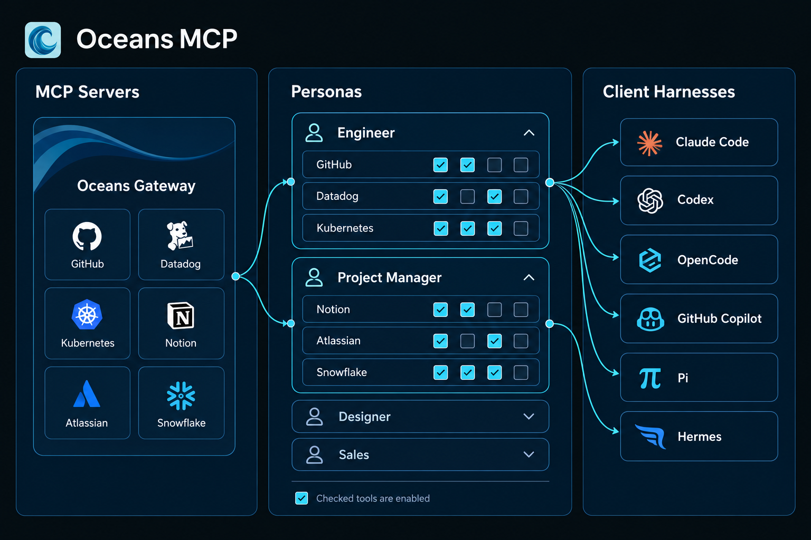
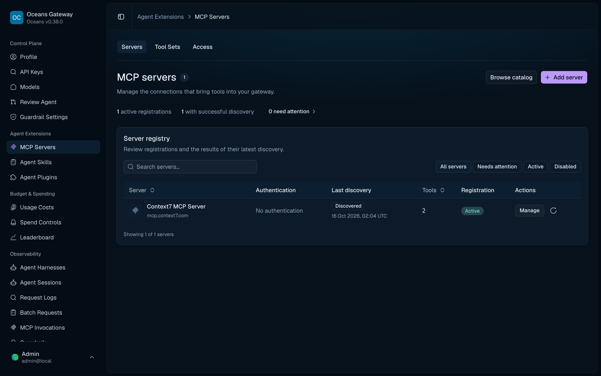
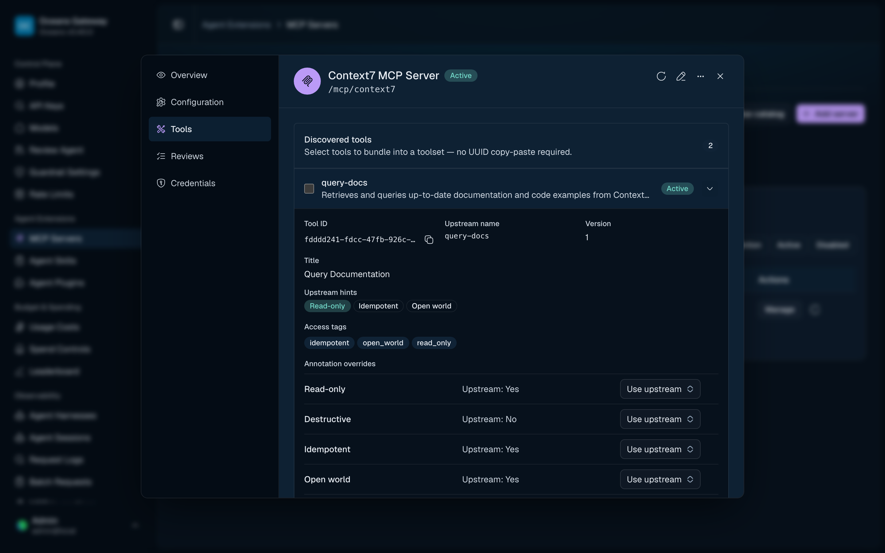

# MCP Servers

`See also`: [MCP Client Setup](../mcp/mcp-client-setup.md), [MCP Tool Access](../mcp/mcp-tool-access.md), [Identity and Access](../access/identity-and-access.md), [Admin Control Plane](../access/admin-control-plane.md), [MCP Registry and Discovery](../contributing/mcp/mcp-registry-and-discovery.md)

## Servers, Personas, and Client Harnesses

Oceans connects registered MCP servers to client harnesses through a single gateway. Use company personas to organise the tools each role needs.



- **MCP Servers** provide tools from services such as GitHub, Datadog, Kubernetes, Notion, Atlassian, and Snowflake. Admins register these servers in Oceans and discover their available tools.
- **Personas** describe tool selections for company roles, such as Engineer, Project Manager, Designer, and Sales. In Oceans, build these selections with [toolsets and access grants](../mcp/mcp-tool-access.md). The diagram shows example selections; checked boxes represent enabled tools. Effective access depends on the active grants for the client's API key and its owner.
- **Client Harnesses** are the applications that use these tools, such as Claude Code, Codex, OpenCode, GitHub Copilot, Pi, and Hermes. Configure each harness to connect to Oceans with an API key. See [MCP Client Setup](../mcp/mcp-client-setup.md) for endpoint and authentication details.

## Gateway Endpoints



Oceans can register external Streamable HTTP MCP servers and expose them to MCP clients through two gateway data-plane routes:

```text
/mcp
/mcp/{server_key}
```

`/mcp` is the aggregate endpoint. It exposes `search_tools`, `describe_tool`, and `call_tool` over the caller's granted active tools across all registered servers.

`/mcp/{server_key}` is the direct proxy endpoint. The gateway authenticates the caller with an Oceans API key, looks up the active registered server, applies any gateway-managed upstream credential, and proxies the MCP Streamable HTTP request to the registered server URL.

Discovered tools are not automatically callable. Configure explicit MCP tool or toolset grants before clients can see tools in `tools/list` or call them with `tools/call`; see [MCP Tool Access](../mcp/mcp-tool-access.md).

## Add a Server

Platform admins, and team owners and admins, manage servers in the admin UI:

```text
/admin/mcp/servers
```

The Servers tab is the registry workspace. It separates durable server records from
the recommended catalog so admins can see exactly which upstreams are registered
and which entries are only suggestions.

The page supports:

- importing a recommended catalog entry
- adding a custom Streamable HTTP server
- discovering a server's OAuth settings from its URL (**Discover OAuth**), then
  reviewing and overriding them before saving
- editing display name, URL, auth mode, auth config, and timeout
- disabling a server, and enabling it again, from **More actions** in the server
  detail dialog
- refreshing discovery
- opening a server detail dialog to inspect overview, configuration, discovered
  tools, and credential bindings
- filtering the registry by owner, and showing each server's owner and visibility

Team owners and admins see their team's servers and the servers published to the
organisation. They manage only their team's servers. See
[Ownership and Visibility](#ownership-and-visibility).

Disabling takes effect immediately: callers lose the server's tools, and there is
no confirmation step. Enabling restores the tools, toolset memberships, and grants
the server had before. Its discovery status reads **Not discovered** until you
refresh discovery, so refresh it to pick up upstream changes made while it was off.

The corresponding admin API surface is documented for maintainers in [MCP Registry and Discovery](../contributing/mcp/mcp-registry-and-discovery.md).

## Ownership and Visibility

Every server has an owner: a team, or the platform. Servers registered before
ownership existed are platform-owned and published to the organisation, so their
access did not change.

| Field | Meaning |
|---|---|
| `owner_team_id` | The owning team. `null` means the platform owns the server. |
| `owner_contact` | Who to ask about the server, such as an email or a chat channel. Up to 256 characters. It defaults to the email of whoever registered the server. |
| `visibility` | `team` or `organisation`. |

Visibility decides who may be granted the server's tools. It never grants access
by itself:

- **`team`**, the default for a team-owned server. Its tools can be granted only
  to the owning team, its members, its service accounts, and API keys they own.
  This applies to platform admins too. Its tools cannot join a tool set. Other
  teams' admins do not see the server.
- **`organisation`**. Every team admin sees the server in the registry, read-only
  unless their team owns it. Platform admins can grant its tools to anyone and add
  them to tool sets. A platform-owned server is always `organisation`.

Setting `organisation` publishes the server. By default only platform admins can
publish. To let team owners and admins publish their own team's servers, set:

```yaml
mcp:
  registry:
    organisation_publishing: team_admins   # default: platform_admins
```

A team admin can always unpublish their own server. Narrowing a server to `team`,
or moving a team-only server to another team, fails with `409` while one of its
tools is in an active tool set or granted to a subject outside the new owning team. Revoke
those first. A disabled server's tool sets and grants reach no one, so they never
block a narrowing. An unpublish saved with other settings is one write: when it
is refused, none of the other settings are saved either. Adding a team-only server's tools to a tool set also fails with `409`.
A grant or credential binding saved while its server changes owner or visibility
fails with `409` and writes nothing; reload the server and try again.

### What team owners and admins can do

Team owners and admins reach the MCP area when the `team_admins` permission group
includes the `mcp` page, which it inherits from the `users` group by default.

Every other signed-in user also gets the `mcp` page by default, through the `users` group. They see, read-only, only the servers they can connect to: those where a grant to them, their team, or one of their own API keys reaches an active tool. Each server shows its owner, its URL's origin and the tools they can call. Every write and the grant, credential and tool set routes stay admin-only. See [MCP Tool Access](../mcp/mcp-tool-access.md) for how grants decide that access.

| Action | Team owner or admin |
|---|---|
| See servers | Their team's servers, and every `organisation` server read-only. For servers they don't manage, only the URL's origin (`scheme://host[:port]`) is shown, and the auth config and discovery errors are hidden |
| Register a server | Yes, at an address that resolves and is public. It is owned by their team and starts as `team`. They cannot name gateway secrets (`env/...`) in its auth config, and one a platform admin set stays only while the server URL and every URL in the auth config are unchanged. A platform admin registers servers on internal networks or with gateway secrets, including for a team |
| Edit, disable, re-enable, refresh discovery | Their team's servers. A disable or re-enable names the owner it was authorized against, so it fails with `409` if the server changed owner meanwhile |
| Change visibility and contact | Their team's servers. Publishing follows `organisation_publishing` |
| Grant tools | Tools of their team's servers, to their team, its members, its service accounts, and their API keys |
| Revoke grants | Any grant on their team's servers' tools |
| Tool sets | No. Tool sets are platform-managed |
| Credential bindings | On their team's servers: set team and service-account credentials as encrypted secrets (not `secret_ref`), and revoke any binding |
| Change the owning team | No |

A server they cannot see returns `404`. An action they cannot take on a server
they can see returns `403`.

A team-owned server's traffic, for discovery and for every call through the
gateway, reaches public addresses only, checked each time it connects. A URL
entered by IP address or as `localhost` keeps that address's own kind, and a
host listed under `mcp.oauth.private_network_hosts` may also reach private
networks. Only a platform admin can save a URL on a listed host; a team admin's
attempt returns `400`. A link-local or cloud metadata address is never reached. Its OAuth
token and registration requests are scoped by each endpoint's own URL the same
way. A platform admin who registers a server on an internal network for a
team by hostname lists that host there. This traffic follows no redirects and
does not use an HTTP proxy. Platform-owned servers are not limited.

A server keeps this guard after a platform admin takes it over, because its
team may have chosen its URL and auth endpoints. Saving the server's settings as
a platform admin vouches for them and lifts the guard; the save is recorded in
the audit log with `destinations_vouched: true`, even when no setting changed.

### Take over a server

Platform admins move a server to another team, or take it over for the
platform, from the server's **Overview** in the admin UI, or with:

```text
PUT /api/v1/admin/mcp/servers/{server_id}/owner
{ "owner_team_id": null }
```

`owner_team_id` is required: a team ID, or `null` to move the server to the
platform and publish it to the organisation. The request can also set `owner_contact` and `visibility`. Each
change is recorded as `mcp_server.ownership_transferred` in the
[admin audit log](../access/admin-audit-log.md).

See [Delegated MCP Server Ownership](../adr/2026-10-17-delegated-mcp-server-ownership.md)
for the reasoning behind these rules.

## View Discovered Tools

Open a server from the Servers table, then use the **Tools** tab in the detail
dialog.



Each discovered tool row is collapsed by default. The collapsed row shows:

- selector checkbox
- tool name
- description, truncated when long
- active/inactive status

Expand a row to inspect:

- stable Oceans tool id
- upstream tool name
- display title, when the server declares one
- hint badges the upstream server declares: **Read-only**, **Destructive** or
  **Non-destructive**, **Idempotent**, and **Open world** or **Closed world**
- schema version
- persisted JSON input schema
- output schema, when the server declares one

The JSON schema is the contract that `describe_tool` returns for aggregate MCP
clients and the schema that direct `tools/call` requests are checked against.
Schema hashes remain part of the backend drift contract, but the admin UI keeps
the row focused on the values humans need when selecting tools.

Hint badges come from the tool's `annotations`. They are claims made by the
upstream server, not checks made by Oceans, so treat them as review aids. A tool
that declares `readOnlyHint` shows **Read-only** and never **Destructive**,
because the protocol ignores `destructiveHint` on read-only tools. An omitted
`destructiveHint` or `openWorldHint` means true, so **Non-destructive** and
**Closed world** appear only when the server declares false. A tool that
declares no annotations shows no badges.

When one or more active tools are selected, use **Add to toolset** to move to the
Toolsets workflow with those tools preselected. Inactive tools remain visible for
audit and drift review, but they cannot be selected or called.

## Recommended Catalog

Recommended entries are curated shortcuts for common MCP servers. They are not
tenant records, do not imply access, and are never executed until an admin
imports or customizes them into a registered server.

Use **Import** when the catalog defaults are acceptable. Use **Customize** when
you need to review or change the key, URL, auth mode, timeout, or display name
before registration.

## Server Keys

`server_key` is the public namespace used in direct `/mcp/{server_key}` URLs and aggregate tool addresses such as `mcp://github/tools/issues.create`.

Rules:

- 3 to 64 characters
- lowercase letters, digits, hyphen, and underscore
- stable once clients are configured
- unknown or disabled servers return not found

## Auth Modes

Supported stored auth modes are:

- `none`: no upstream credential is added.
- `gateway_static_header`: the gateway adds one shared API key, either as a header (optionally wrapped by a value template) or as a URL query parameter. The admin UI labels this mode **Gateway static credential**.
- `gateway_bearer_token`: the gateway adds an upstream `Authorization: Bearer ...` header.
- `user_passthrough`: resolve a caller-owned user/service-account/team credential binding at execution time.
- `oauth_obo`: resolve and refresh a user-owned OAuth credential at execution time. The OAuth client comes from a configured provider (`google` or `oauth2`) or from the server's own authorization server, found by [OAuth discovery](#oauth-for-any-mcp-server).

Discovery normally uses `none`, `gateway_static_header`, or `gateway_bearer_token`. An `oauth_obo` server can set `auth_config.discovery_auth` to `none` when its upstream permits public `initialize` and `tools/list` requests. Execution still requires a user OAuth connection.

## Google Workspace OAuth

Google Drive and Google Docs are separate upstream MCP servers. Oceans can expose both through one aggregate `/mcp` endpoint. The client harness authenticates to Oceans with an Oceans API key. It does not receive a Google token, Google client secret, or Google callback URI.

Use Google's [Drive MCP guide](https://developers.google.com/workspace/drive/api/guides/configure-mcp-server) and [Workspace MCP guide](https://developers.google.com/workspace/guides/configure-mcp-servers) when you configure the Google Cloud project and consent screen.

Complete these Google Cloud steps before you enable the Oceans connection page:

1. Join the Google Workspace Developer Preview when Google requires it for the selected account or project.
2. Enable the Drive API, Docs API, Drive MCP API, and Docs MCP API in the same Cloud project.
3. Configure the OAuth consent screen, audience, test users, and the two read-only scopes used below.
4. Create a **Web application** OAuth client and register the exact Oceans callback URI.
5. Publish or verify the consent application as required for the audience and restricted scopes.

Configure one Google confidential OAuth client in gateway configuration:

```yaml
mcp:
  oauth:
    public_base_url: https://gateway.example.com
    providers:
      - key: google
        provider_type: google
        client_id: env.OCEANS_MCP_OAUTH_GOOGLE_CLIENT_ID
        client_secret: env.OCEANS_MCP_OAUTH_GOOGLE_CLIENT_SECRET
```

Register this exact callback URI in the Google OAuth client:

```text
https://gateway.example.com/api/v1/mcp/oauth/google/callback
```

The recommended Drive and Docs catalog entries set the provider key, OAuth resource, read-only scope, and public discovery mode. Drive requests `drive.readonly`. Docs requests only `documents.readonly` for `read_doc`. A harness can use the separate Drive tools to find a document, then pass its ID to Docs.

After an admin imports both entries and completes discovery, each user opens `/admin/account/connections` and grants access separately for Drive and Docs. Oceans uses authorization code flow with PKCE and the OAuth `resource` parameter. It stores the access and refresh tokens in the existing encrypted user credential binding. It refreshes the access token five minutes before expiry and requires a new connection after Google revokes the grant.

The harness must use an Oceans API key owned by that user to resolve the user's Google bindings. Service-account keys do not borrow user credentials. They require a separately managed service-account or team binding.

Disconnecting a server revokes its Oceans binding at once, but it does not call Google's token revocation endpoint. Google revocation removes the grant for the whole Cloud project and can invalidate both Drive and Docs tokens that use the same OAuth project. A user who wants to remove all project access can revoke the application from Google Account settings. Oceans then reports `credential_required` for each affected server.

Use read-only tools for the first toolset:

- Drive: `download_file_content`, `get_file_metadata`, `get_file_permissions`, `list_recent_files`, `read_file_content`, and `search_files`
- Docs: `read_doc`

Do not add Drive `copy_file` or `create_file`, or Docs `update_doc`, to a read-only toolset. OAuth scopes remain the main permission boundary, but a narrow toolset gives callers a clear contract.

Google classifies `drive.readonly` as a restricted scope. An external production application can require Google verification and a security assessment. Confirm the current Google requirements before production rollout.

Workspace content is untrusted model input. Keep the write tools disabled for the first toolset, review tool grants, and apply the prompt-injection controls in Google's [Workspace MCP security guidance](https://developers.google.com/workspace/guides/configure-mcp-security).

## OAuth for Any MCP Server

Any remote MCP server that follows the MCP authorization spec can use per-user OAuth without a gateway configuration change. Each user connects their own account from `/admin/account/connections`, and Oceans stores and refreshes their tokens the same way it does for Google.

Set `mcp.oauth.public_base_url` first. Every user connection, including the ones below, needs it for the callback URL:

```yaml
mcp:
  oauth:
    public_base_url: https://gateway.example.com
```

Servers that use their own authorization server share this callback URI:

```text
https://gateway.example.com/api/v1/mcp/oauth/callback
```

### Register a server by URL

1. Open **Add server** on `/admin/mcp/servers` and enter the server URL.
2. Select **Discover OAuth**. Oceans sends an unauthenticated request to the server, then reads:
   - the protected-resource metadata (RFC 9728) named by the `WWW-Authenticate` challenge, or at `/.well-known/oauth-protected-resource`
   - the authorization-server metadata (RFC 8414) at `/.well-known/oauth-authorization-server`, falling back to OpenID Connect discovery
3. Review what discovery found: the resource, the authorization server, its endpoints, the default scopes, how Oceans will get a client, and any warnings.
4. Select **Use discovered settings**. The auth mode becomes `oauth_obo` and the auth config JSON is filled in. Edit it to override any value, such as the scopes, then save. The `issuer` and endpoints must stay the ones the authorization server publishes, as the next section explains.

Discovery only reads metadata. It stores nothing until you save the server. Metadata URLs must use HTTPS. Plain HTTP is accepted only when both the MCP server and the metadata are on a loopback host, for local development. Every metadata, registration, and token request for the server reaches public addresses only, unless you entered the server by IP address (its own kind of address applies), as `localhost`, or by a host listed under `mcp.oauth.private_network_hosts`. A server on a private network registered by hostname needs that entry. No server can reach link-local or cloud metadata addresses. Requests do not follow redirects or use an HTTP proxy. See [ADR: SSRF-safe outbound fetch](../adr/2026-10-17-ssrf-safe-outbound-fetch.md). Oceans refuses an authorization server that lists PKCE methods without `S256`.

A discovered server's auth config looks like this:

```json
{
  "resource": "https://mcp.linear.example/mcp",
  "resource_indicator": true,
  "issuer": "https://auth.linear.example",
  "authorization_endpoint": "https://auth.linear.example/authorize",
  "token_endpoint": "https://auth.linear.example/token",
  "registration_endpoint": "https://auth.linear.example/register",
  "client_registration": "dynamic",
  "token_endpoint_auth_method": "client_secret_basic",
  "scopes": ["read"]
}
```

| Field | Meaning |
| --- | --- |
| `resource` | The protected resource. It must share an origin with the server URL. |
| `resource_indicator` | Whether authorization and token requests send the RFC 8707 `resource` parameter. Discovery sets it to `true` when the server publishes protected-resource metadata. Defaults to `true`. |
| `issuer`, `authorization_endpoint`, `token_endpoint` | The authorization server. The endpoints, and `registration_endpoint` when set, must be the ones the issuer's metadata publishes. |
| `scopes` | Scopes to request and require. Discovery fills them from the challenge's `scope`, then from the resource's `scopes_supported`. Omit them to let the authorization server choose. |
| `client_registration` | How Oceans gets its OAuth client: `dynamic`, `metadata_document`, or `manual`. |
| `token_endpoint_auth_method` | `client_secret_basic`, `client_secret_post`, or `none`. |
| `authorization_response_iss_parameter_supported` | Whether the authorization server returns `iss` with every authorization response (RFC 9207). Discovery copies it from the authorization server metadata. When `true`, a callback without `iss` is refused. Defaults to `false`. |

Every connection to a server with its own authorization server records the expected issuer. If the callback carries an `iss` that names a different issuer, Oceans refuses the code and redirects to the connections page with `oauth_error=issuer_mismatch`. The code is never sent to the token endpoint. This stops an upstream whose metadata sends users to another authorization server from receiving that server's codes (a mix-up attack), because all these servers share one callback URI and, with `metadata_document`, one client ID. The issuers must match exactly, except that one trailing `/` at the end of the path is ignored, so servers saved before discovery recorded the issuer exactly as the metadata states it keep connecting.

The issuer check only proves which authorization server sent a code, so the code must also go to that server's own token endpoint. When a save creates a server with its own authorization server, or changes its `issuer`, `authorization_endpoint`, `token_endpoint` or `registration_endpoint`, Oceans reads the issuer's metadata, as discovery does, and refuses the save with `400` unless each configured endpoint is the one the metadata publishes. An issuer that publishes no metadata is refused; use a [configured `oauth2` provider](#a-configured-oauth2-provider) for it. Edits that leave these fields as they are fetch nothing, so a server saved before this check keeps working until its endpoints change.

### Client registration

Discovery recommends a registration method in this order:

- **`dynamic`**, when the authorization server has a `registration_endpoint`. The first user to connect causes Oceans to register itself (RFC 7591) with the shared callback URI. Oceans stores the issued client once per server. The client secret and registration access token are encrypted with `OCEANS_MCP_CREDENTIAL_ENCRYPTION_KEY`. Oceans registers again only when the authorization server or callback changes, or the secret expires. A refresh never registers a new client. Changing the server's URL, auth mode or auth config drops the registered client and revokes every user's OAuth tokens for the server, so each user connects again.
- **`metadata_document`**, when the authorization server sets `client_id_metadata_document_supported`. Oceans uses the URL of a Client ID Metadata Document that the gateway hosts as its client ID. It connects as a public client protected by PKCE:

  ```text
  https://gateway.example.com/api/v1/mcp/oauth/client-metadata.json
  ```

  The document is public and lists only the client name, the callback URI, and the grant types.
- **`manual`**, when the authorization server supports neither. Register an OAuth app with the upstream using the shared callback URI, then set `client_id`. Set `client_secret_ref` to an `env/OCEANS_MCP_DISCOVERY_*` variable for a confidential client:

  ```json
  {
    "client_registration": "manual",
    "client_id": "oceans-gateway",
    "client_secret_ref": "env/OCEANS_MCP_DISCOVERY_LINEAR_CLIENT_SECRET"
  }
  ```

### A configured `oauth2` provider

To share one admin-created OAuth app across servers, or to keep client credentials in gateway configuration, add an `oauth2` provider with explicit endpoints:

```yaml
mcp:
  oauth:
    public_base_url: https://gateway.example.com
    providers:
      - key: linear
        provider_type: oauth2
        client_id: env.OCEANS_MCP_OAUTH_LINEAR_CLIENT_ID
        client_secret: env.OCEANS_MCP_OAUTH_LINEAR_CLIENT_SECRET   # optional
        authorization_url: https://auth.linear.example/authorize
        token_url: https://auth.linear.example/token
        scopes: [read]                                            # optional defaults
        token_endpoint_auth_method: client_secret_basic           # optional
```

Register this callback URI with the upstream OAuth app:

```text
https://gateway.example.com/api/v1/mcp/oauth/linear/callback
```

A server then references the provider instead of naming an authorization server:

```json
{
  "provider_key": "linear",
  "resource": "https://mcp.linear.example/mcp"
}
```

Without `client_secret`, the provider is a public client and `token_endpoint_auth_method` defaults to `none`. With a secret, it defaults to `client_secret_basic`. When the server sets no `scopes`, Oceans requests the provider's `scopes`. Provider keys may use letters, digits, `-`, and `_`. The key `mcp_server` is reserved.

### Tokens, refresh, and expiry

Connections behave the same way for every provider. Oceans:

- runs the authorization code flow with PKCE
- refreshes the access token five minutes before it expires
- serializes refreshes across gateway replicas with the same lease
- replaces the stored refresh token when the provider rotates it
- revokes the connection and asks the user to reconnect after `invalid_grant`
- stores the token, and a dynamically registered client, only while the server
  still has the URL and auth settings the flow ran against; a settings change
  in between fails the connection, and the user connects again
- lists, and lets a user connect to, a team-only server only while their current
  team owns it, checked again when the provider redirects back; a connection
  they already hold stays listed so they can disconnect it

Some providers return no refresh token. The connection then lasts until the access token expires, and then the user must reconnect. A token with no refresh token and no `expires_in` does not expire.

When a call needs a connection the user has not made, or one that has expired, the `credential_required` or `credential_expired` error includes a connect URL. This works for every OAuth server whose callback is reachable. See [Return a connect URL](../adr/2026-10-13-mcp-credential-connect-url.md).

Changing a server's `provider_key`, `issuer`, `resource`, or required scopes marks existing connections **Expired** on the connections page. Each user must then reconnect.

## Gateway-Managed Upstream Credentials

Gateway-managed credentials are for the upstream MCP server only. They are not caller credentials and are never returned to admin UI clients.

For `gateway_static_header`, send the key as a header:

```json
{
  "header_name": "X-API-Key",
  "secret_ref": "env/OCEANS_MCP_DISCOVERY_EXAMPLE_KEY"
}
```

Wrap the key in a value template when the upstream expects a prefix. The template must contain `{{api_key}}` exactly once:

```json
{
  "header_name": "Authorization",
  "value_template": "Token {{api_key}}",
  "secret_ref": "env/OCEANS_MCP_DISCOVERY_EXAMPLE_KEY"
}
```

Or send it as a URL query parameter:

```json
{
  "query_param": "api_key",
  "secret_ref": "env/OCEANS_MCP_DISCOVERY_EXAMPLE_KEY"
}
```

Set exactly one of `header_name` or `query_param`. `value_template` applies only to headers. A query parameter name may use letters, digits, `-`, `_`, `.`, and `~`. The stored `server_url` must not already contain the parameter.

The query value never enters the stored `server_url`. Oceans adds it to the URL only when it sends each discovery or proxy request. Debug output redacts it. Transport errors drop the URL before they are logged or returned, so the value does not reach logs, traces, or error messages. Prefer a header when the upstream accepts one, because the upstream's own access logs may still record query strings.

For `gateway_bearer_token`:

```json
{
  "secret_ref": "env/OCEANS_MCP_DISCOVERY_EXAMPLE_TOKEN"
}
```

Credentialed modes require an HTTPS `server_url`. Secret references must use `env/OCEANS_MCP_DISCOVERY_*`. The environment variable is resolved by the gateway process during discovery and proxying.

Inbound Oceans credentials are always stripped before forwarding upstream. The gateway forwards only MCP protocol/runtime headers plus configured gateway-managed upstream auth.

## Principal-Bound Upstream Credentials

For `user_passthrough`, admins can configure MCP credential bindings in the control plane. Team owners and admins can set team and service-account bindings on their own team's servers; user bindings stay with each user or a platform admin. For a configured `oauth_obo` server, users should create and revoke their own binding from **Workspace connections**. Bindings are separate from server registry records and grants:

- owner scopes are `user`, `team`, or `service_account`
- material kinds are `static_header`, `bearer_token`, or `oauth_tokens`
- storage is either an encrypted blob or a `secret_ref`
- raw secrets are accepted only on submission and are never returned by admin APIs

Encrypted bindings require `OCEANS_MCP_CREDENTIAL_ENCRYPTION_KEY` to be set to a base64-encoded 32-byte key in the gateway process. Use a separate key from other gateway encryption keys. Credential `secret_ref` values must use `env/OCEANS_MCP_CREDENTIAL_*`.

The gateway does not start with a configured MCP OAuth provider unless this encryption key is present and valid.

Runtime resolution order:

- user-owned API key: user binding, then team binding
- service-account API key: service-account binding, then owning-team binding

Grant checks happen before credential lookup. A denied tool address does not reveal whether a credential exists.

## Discovery

Discovery is the current server health signal.

Refresh discovery from the admin UI after adding or editing a server. Discovery:

- initializes Streamable HTTP
- lists upstream tools
- stores normalized tool schemas, plus each tool's `title`, `annotations`, and
  `outputSchema` when the server declares them
- updates schema hashes and schema versions
- marks missing tools inactive
- records bounded failure summaries

No separate ping health check or discovery-run history UI exists in this slice.

A tool's schema hash covers its input schema, title, annotations, and output
schema. A change to any of them bumps the schema version and makes `call_tool`
reject a stale caller-supplied `schema_hash`. A tool with none of the three
optional members keeps the hash of its input schema alone. Invalid optional
members, such as a non-object `outputSchema`, are dropped rather than failing
discovery. For tools discovered before Oceans stored these members, the first
discovery that captures them updates the hash without bumping the version unless
the input schema also changed. See
[Store MCP tool metadata in the schema hash](../adr/2026-10-13-mcp-tool-metadata-and-schema-hash.md).

Every new hash is stored as a tool version. With **Require approval for tool
changes** on, new and changed tools wait for an admin before they are served.
See [Tool versions and approval](../mcp/mcp-tool-access.md#tool-versions-and-approval).

## Access

On `/mcp`, `search_tools`, `describe_tool`, and `call_tool` resolve only active tools granted to the authenticated API key, owner user, owner service account, or team.

On `/mcp/{server_key}`, `tools/list` responses are filtered to granted active tools for that server. `tools/call` is rejected before upstream when the tool is not granted. Disabled servers, inactive tools, disabled toolsets, revoked grants, inactive memberships, missing credentials, and expired credentials do not resolve as callable access.

Granted tool calls on both endpoints also count against `mcp_tool_call` [rate limits](rate-limits.md), per server and per key, user, team, or the whole gateway. A call over a limit gets HTTP `429` with JSON-RPC error `-32029`, `Retry-After`, and `X-RateLimit-*` headers, and never reaches the upstream server.
