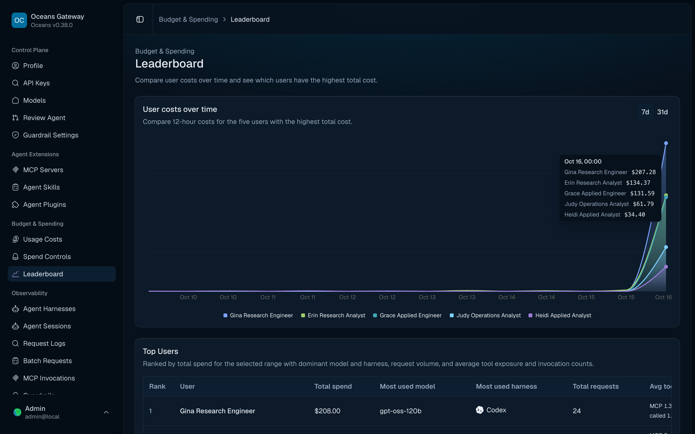
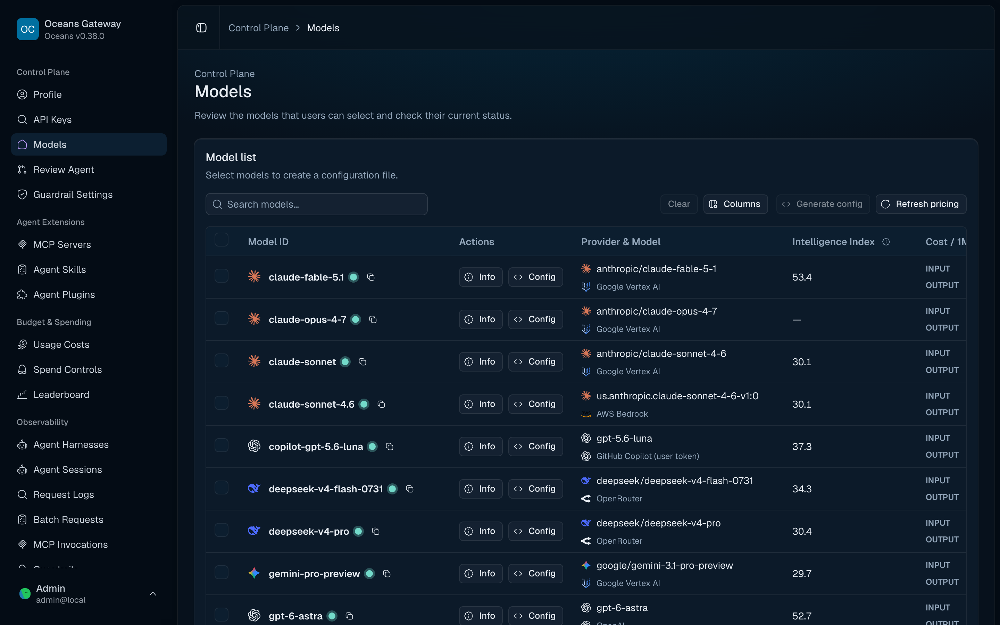
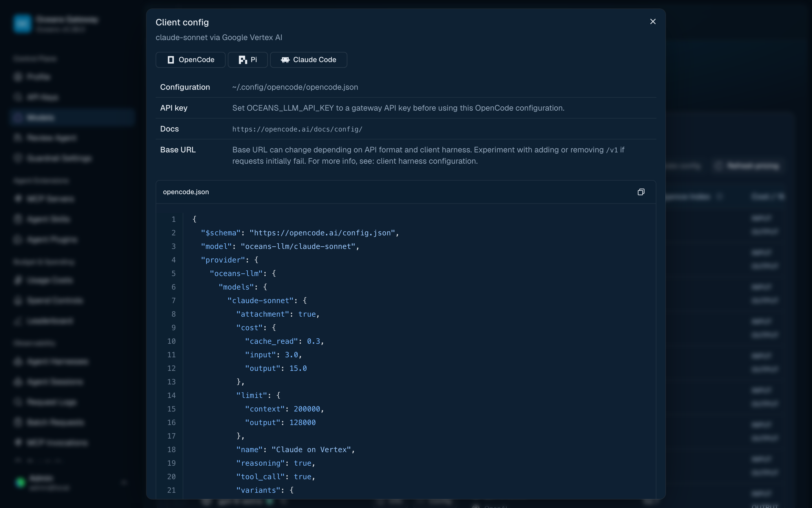
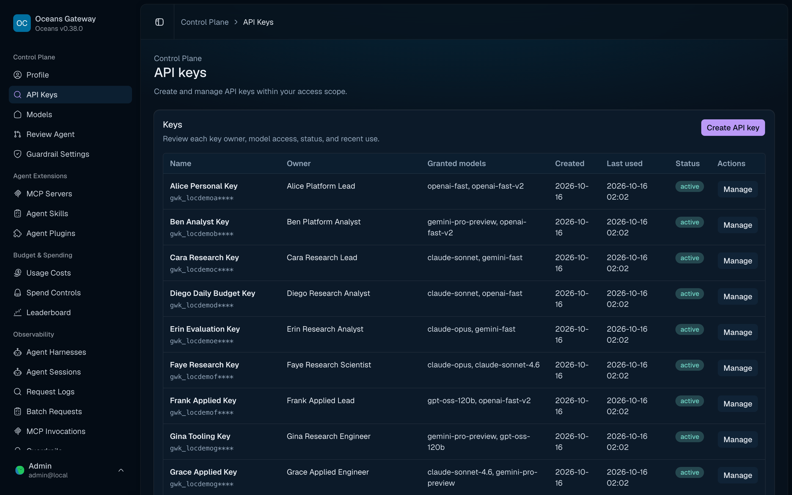
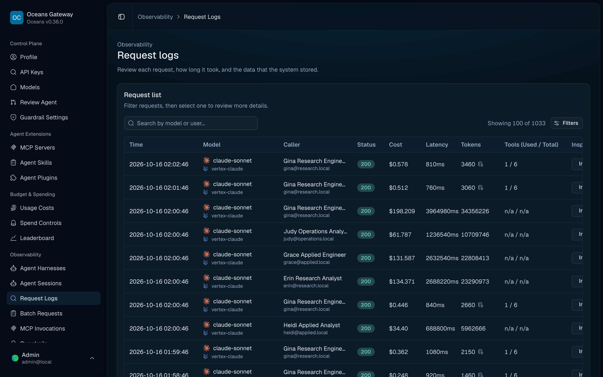
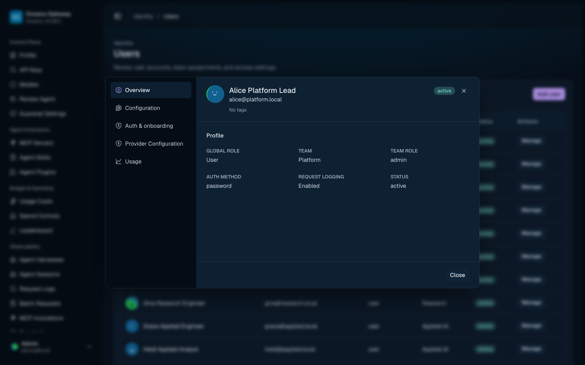

# Screenshots

`See also`: [Admin Control Plane](../../access/admin-control-plane.md), [Observability and Request Logs](../../operations/observability-and-request-logs.md), [Admin API Contract Workflow](admin-api-contract-workflow.md)

Reference screenshots for the admin UI. These images are useful when reviewing documentation, release notes, and user-facing workflow changes.

## Capturing screenshots

Capture every admin UI image the same way so pages look consistent side by side:

- **Size.** A 1440 × 900 CSS-pixel viewport at device scale factor 2, so full-page images are 2880 × 1800 PNG. Crops of a dialog or the page content keep the same scale.
- **Data.** A fresh `gateway.db` with the local demo seed (`mise run dev-stack`, or the `verify-oceans-admin` stack), so no leftover verification records appear. Sign in as `admin@local` unless the page needs a role: team admin views use `cara@research.local`.
- **Timing.** Wait for charts to draw and for the page entrance animation (about 300 ms) to finish before capturing.
- **Content.** Mask invite URLs, API keys and tokens. Use neutral example addresses such as `alex@example.com` where an email appears in the URL.
- **Names.** Keep existing file names so documentation links don't change.

## Leaderboard

Shows request and usage ranking across the gateway's observed traffic.

## Models

Shows configured models, provider identity, model metadata, and routing context.

## Model Client Config

Shows generated client configuration snippets for selected models, including setup context, grouped OpenCode/Pi providers, and multi-block clients such as Claude Code `settings.json`.

## API Keys

Shows API key ownership, access grants, lifecycle state, and management actions.

## MCP Servers

Shows registered MCP servers and the recommended catalog.

## MCP Server Tools

Shows the server detail dialog with discovered tools and an expanded JSON schema.

## MCP Toolsets

Shows named bundles of discovered MCP tools used for reusable grants.

## MCP Access Grants

Shows tool and toolset grants plus effective-access preview.

## Request Logs

Shows recent gateway requests with request status, routing, and observability context.

## User Editing

Shows the admin workflow for editing a user record.

