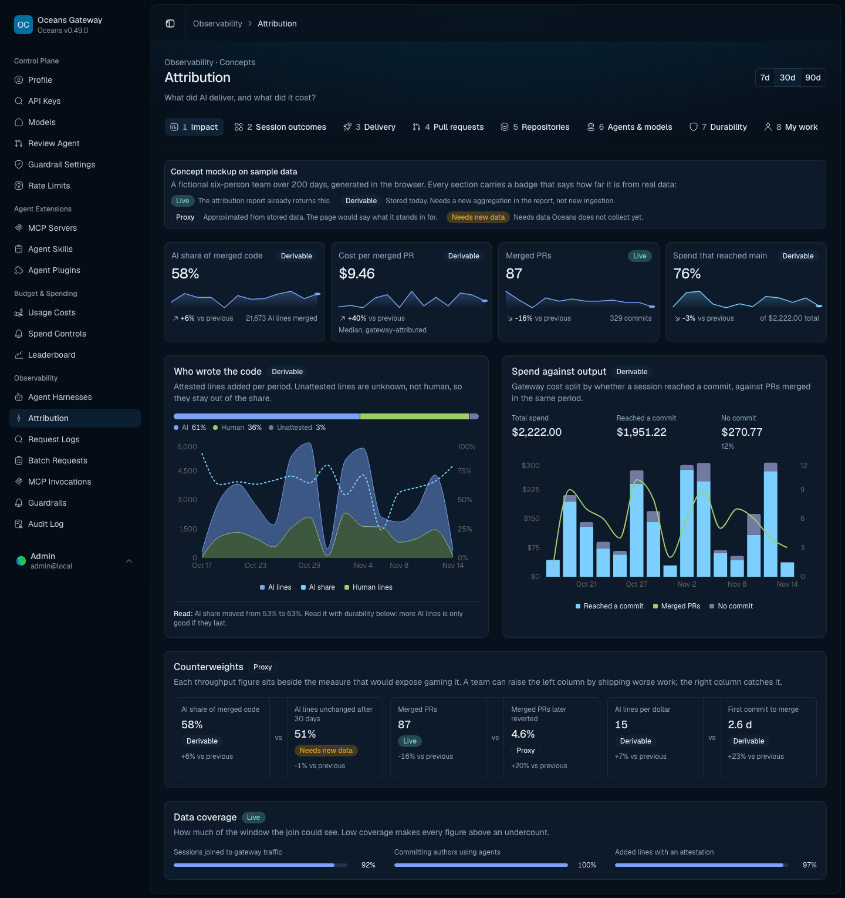
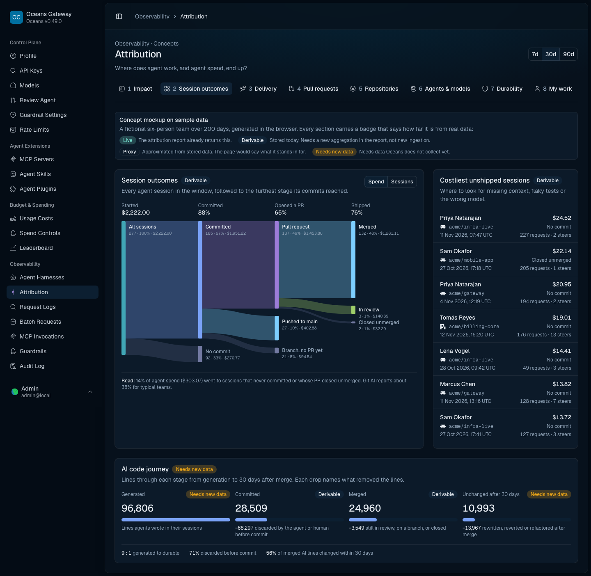
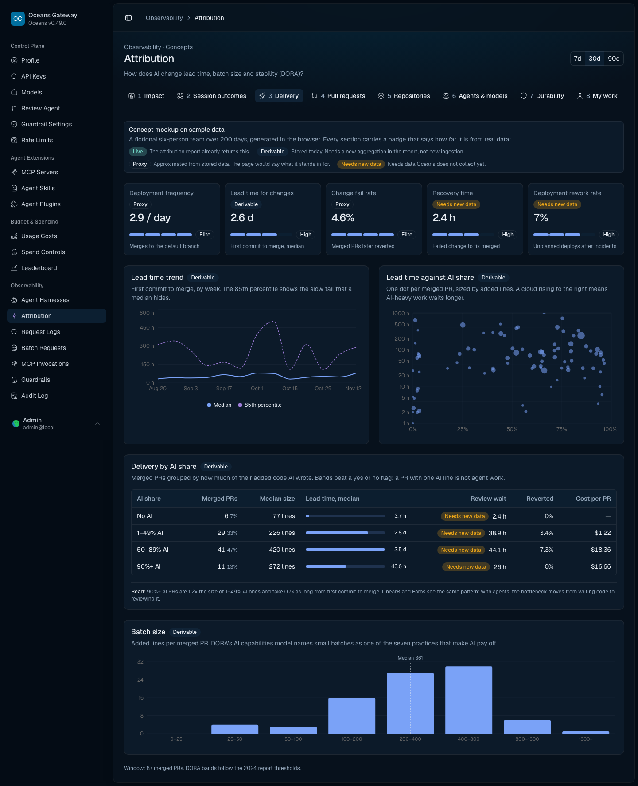
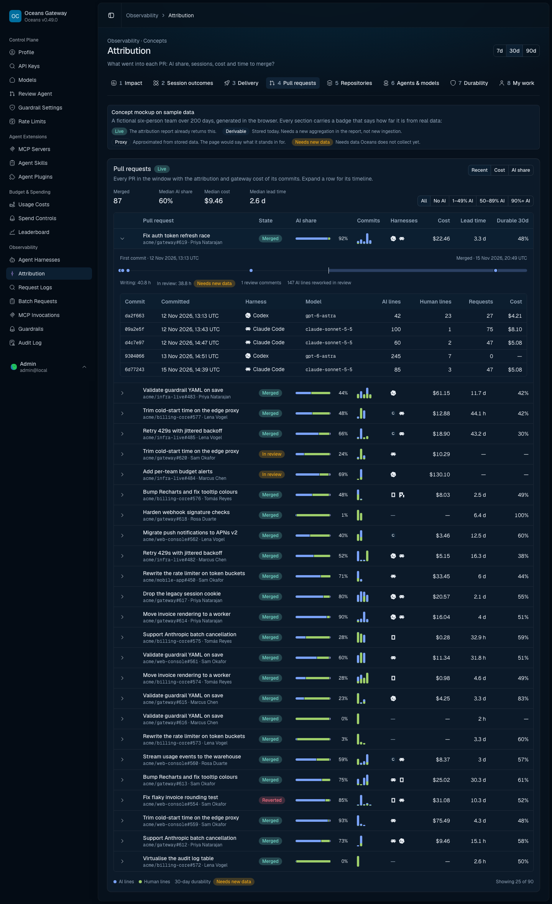
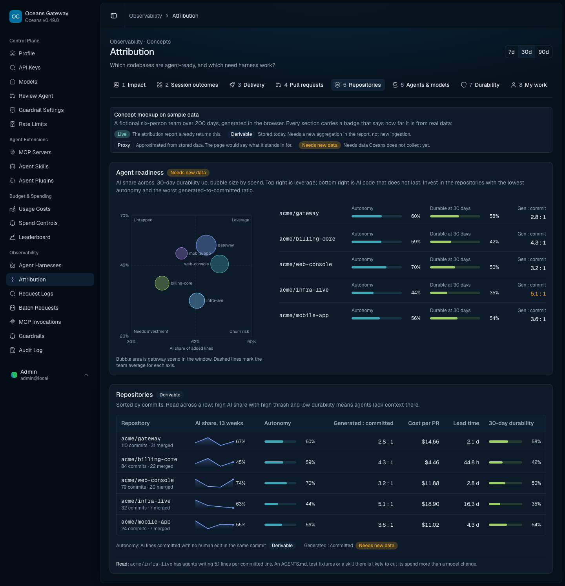
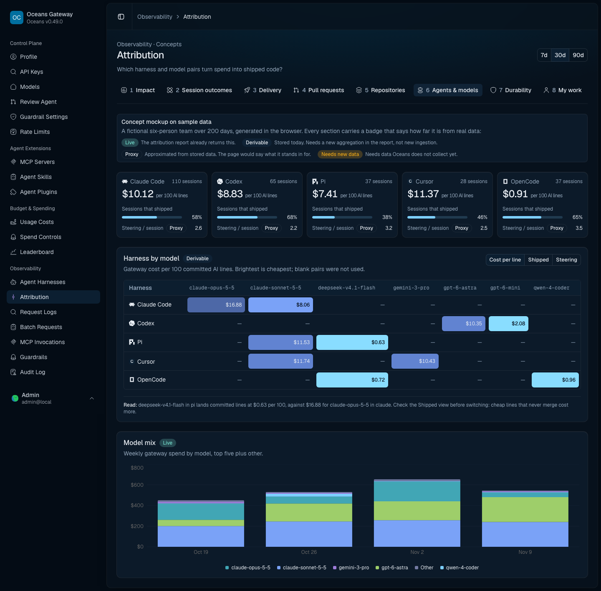
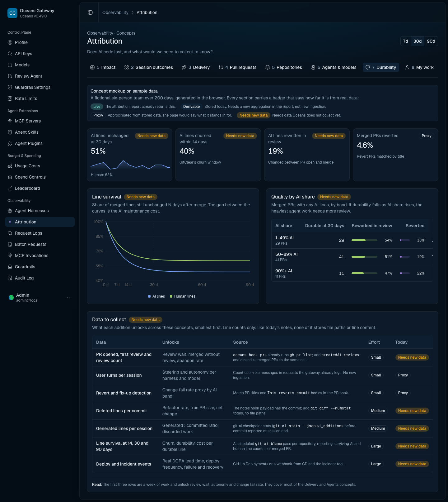
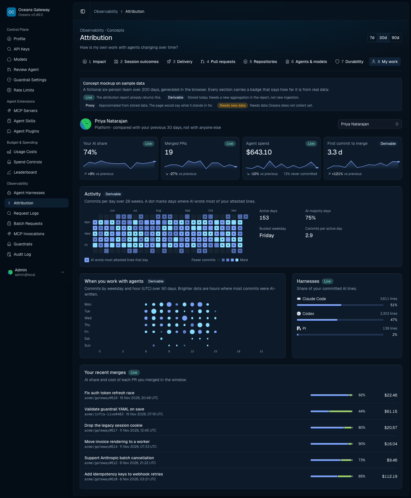

# Attribution: Visualisation Concepts

Status: implemented in part. The live Attribution page now has the Impact (with the session outcomes Sankey), Delivery, Pull requests, Repositories, Durability and My work tabs, each behind `attribution.pages` in the gateway config. Agents & models became the harness tiles and harness × model table on Agent Harnesses. These mockups stay as the guide, behind `attribution.pages.concepts`.
Live mockups: `/admin/observability/attribution/concepts` (`crates/admin-ui/web/src/routes/observability/attribution_.concepts.tsx`)
Stack: shadcn/ui (`radix-nova`, hugeicons) + Recharts 3, on the DESIGN.md tokens. Layouts borrow from ReUI Pro blocks: the `chart-49` trial Sankey, `chart-51` slope chart, `data-grid-advanced-1` in-cell sparklines, and `ai-usage-2` spend map.

The [Git AI attribution ADR](../../adr/2026-11-01-git-ai-attribution-via-oceans-hooks.md) gives Oceans something Git AI's own platform has to build an SCM integration for: each commit's AI and human lines, joined to the gateway requests and cost of the sessions that wrote them. Today's page shows that join as three tables. This proposal explores what the data can answer, and what a little more data would unlock.

The mockups run on a seeded sample team: six people, five repositories, five harnesses, 200 days, generated in the browser. The 7d, 30d and 90d windows recompute every figure. Every section carries a readiness badge:

| Badge | Meaning |
|---|---|
| **Live** | The attribution report already returns it. |
| **Derivable** | Stored today. Needs a new aggregation in the report, not new ingestion. |
| **Proxy** | Approximated from stored data, and labelled with what it stands in for. |
| **Needs new data** | Needs data Oceans does not collect yet. |

## The eight concepts

Each concept is a candidate tab, in the style of the MCP page's section nav.

| # | Tab | Question it answers | Key components | Readiness |
|---|---|---|---|---|
| 1 | **Impact** | What did AI deliver, and what did it cost? | KPI tiles with sparklines and neutral deltas; AI vs human lines (stacked area plus a share line); spend split by commit against merged PRs; **counterweight pairs**; data coverage meters | Mostly derivable |
| 2 | **Session outcomes** | Where do agent work and agent spend end up? | Column Sankey (`FlowChart`) by spend or sessions: started → committed → PR → merged, with drop-offs muted; costliest unshipped sessions; AI code journey (generated → committed → merged → durable) | Derivable; journey ends need new data |
| 3 | **Delivery** | How does AI change lead time, batch size and stability? | DORA tiles with band meters (honest *Proxy* labels); lead time p50/p85 trend; lead time vs AI share scatter; **delivery by AI-share band** table; batch-size histogram | Derivable and proxy |
| 4 | **Pull requests** | What went into each PR? | Git AI-style ledger: AI share bar, **commit strip** (one bar per commit, AI over human), harness marks, cost, lead time, durability; expanding row with a commit timeline and per-commit join | Live rows plus additions |
| 5 | **Repositories** | Which codebases are agent-ready, and which need harness work? | **Readiness quadrant** (AI share × 30-day durability, bubble = spend); table with weekly AI-share sparklines, autonomy, generated : committed, cost per PR, durability | Derivable; durability and generated need new data |
| 6 | **Agents & models** | Which harness and model pairs turn spend into shipped code? | Per-harness tiles (cost per 100 AI lines, shipped share, steering); harness × model **matrix heatmap** with Cost / Shipped / Steering toggles; weekly model mix | Derivable; steering is a proxy |
| 7 | **Durability** | Does AI code last, and what would we need to collect to know? | Survival curves (AI vs human); quality by AI band; **data-to-collect roadmap** ranked by effort | Needs new data (doubles as the roadmap) |
| 8 | **My work** | How is my own work with agents changing? | Personal KPIs against *your own* previous period; contribution calendar with AI-majority dots; weekday × hour punch card; harness share; recent merges | Live and derivable |

## Principles drawn from the research

- **Pair every throughput figure with its counterweight.** SPACE and DORA both warn that one metric invites gaming. AI share sits next to 30-day durability, merged PRs next to reverts, lines per dollar next to lead time. DESIGN.md now records this rule.
- **Use AI-share bands, not a yes/no "AI-assisted" flag.** A PR with one AI line is not agent work. The bands are 0%, under 50%, 50–89% and 90%+. LinearB and Faros find AI-heavy PRs about 2.6× larger, and they wait far longer for review. The Delivery tab is built to show whether that holds here.
- **Spend that never shipped is the gateway's unique view.** Only Oceans sees the requests that never reached a commit. Git AI cites about 38% of spend going to branches that never merge. The Session outcomes tab and the Impact KPI make this the headline.
- **No individual leaderboards.** DX, DORA and GitClear all warn against them, and heavy AI users were already the most productive before AI (GitClear 2026). Teams, repositories, harnesses and models compare with each other. A person compares only with their own baseline (tab 8).
- **Show distributions, not means.** Cost per PR is a median; lead time shows p50 and p85; batch size is a histogram.
- **Lines are not value.** Durability, rework and reverts sit beside every line count. Git AI's ratio of generated to durable lines (their marketing cites 12:1 to 45:1) is the metric most likely to move spend.

## Data to collect, smallest first

These come from the Durability tab's roadmap.

1. **PR lifecycle.** `oceans hook prs` already calls `gh pr list`; add `createdAt`, reviews and closed-unmerged PRs. This unlocks review wait, merged-without-review and abandon rate.
2. **User turns per session.** Count user-role messages in requests the gateway already logs. No new ingestion. This unlocks steering and autonomy per harness and model.
3. **Revert detection.** Match revert PR titles and `This reverts commit`. This gives a change-fail-rate proxy by AI band.
4. **Deleted lines per commit.** Add `git diff --numstat` totals to the notes hook, with no paths. This gives refactor rate and true PR size.
5. **Generated lines per session.** git-ai checkpoint stats sent at session end. This unlocks generated : committed and discarded work.
6. **Line survival at 14, 30 and 90 days.** A scheduled `git ai blame` pass. This unlocks churn, durability and cost per durable line.
7. **Deploy and incident events.** These turn the DORA proxies into real metrics.

Items 1–3 are about a week of work and make most of the Delivery and Agents tabs real.

## Recommendation

Ship in three steps:

1. **Now:**
   - Restructure Attribution into tabs, with today's tables as the Pull requests tab.
   - Add **Impact** without the durability side of the counterweights.
   - Add **Session outcomes**, the Sankey only.
   - Everything in these is derivable from stored rows.
2. **Next:**
   - Collect items 1–3 above.
   - Add **Delivery** and **Agents & models**.
   - Add **My work** for non-admins, replacing their filtered copy of the admin page.
3. **Later:**
   - Collect line survival and generated lines.
   - Turn on **Repositories** (the quadrant needs durability) and **Durability**.

Open questions for the team:

- Should spend that never shipped be framed as *waste*, or as *exploration*? Some unshipped sessions are reviews and research.
- How visible should the personal view be? Owner-only, or shared with the person's team admin?
- Should these stay under Observability, or get a top-level "Engineering impact" section?

## Previews

Full-page captures of each tab at 1440 px, 30-day window, taken from the mockup route.

### 1. Impact

### 2. Session outcomes

### 3. Delivery

### 4. Pull requests (first row expanded)

### 5. Repositories

### 6. Agents & models

### 7. Durability

### 8. My work

