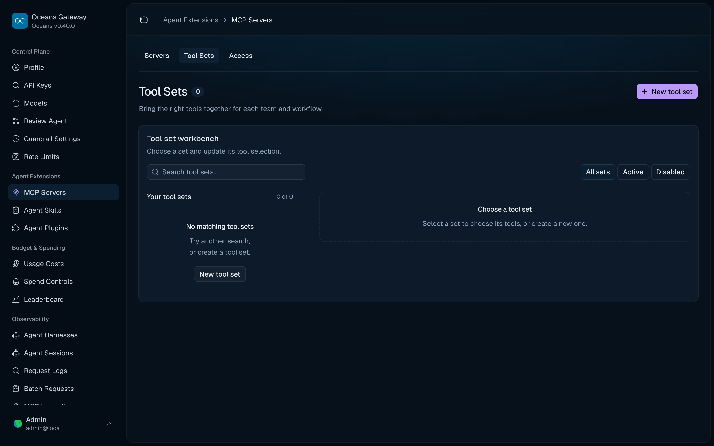
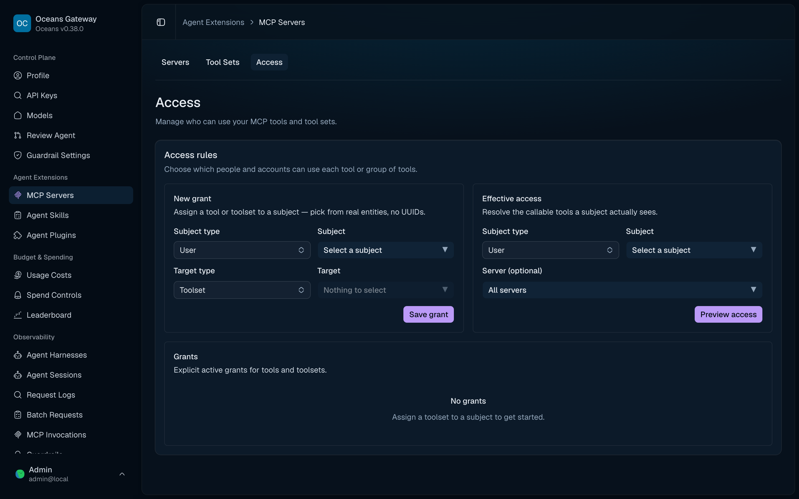

# MCP Tool Access

`See also`: [MCP Servers](../configuration/mcp-servers.md), [MCP Client Setup](mcp-client-setup.md), [Identity and Access](../access/identity-and-access.md), [Budgets](../access/budgets.md), [MCP Invocations](mcp-invocations.md)

MCP tool access controls which discovered tools an Oceans API key can find through `/mcp` and see or call through `/mcp/{server_key}`.

No implicit access exists for every discovered MCP tool. A caller can use a tool only when an active grant or [tag rule](#tag-rules) resolves to that tool for the authenticated API key, owner user, owner service account, or team, and no exclude rule removes it.

## Toolsets

A toolset is a named collection of discovered MCP tools. Use toolsets when API keys, users, service accounts, or teams need the same tool bundle.

Toolsets contain stable `mcp_tool_id` values from discovery. If an upstream tool changes schema, the tool keeps the same id and gets a new schema version. If discovery later marks a tool inactive, grants and toolset membership remain auditable, but the inactive tool is not callable.

Admins manage toolsets from the MCP workspace:

```text
/admin/mcp/toolsets
```



Typical flow:

1. Register or import an MCP server.
2. Refresh discovery so the gateway stores current tools and schemas.
3. Open the server detail dialog and select active tools from the **Tools** tab,
   or create a toolset directly from the **Toolsets** tab.
4. Save the toolset membership.
5. Grant the toolset to the API key, user, team, or service account that should
   see those tools.

Toolsets can contain tools from more than one registered server. Keep them small
and purpose-oriented; they are the main way to keep agent-visible tool catalogs
understandable.

Toolsets are platform-managed and granted organisation-wide, so they hold only
tools of servers published to the organisation. Saving a toolset that holds a tool
of a `team` server returns `409`, even when the set is unchanged, so a server
narrowed to its team cannot keep tools in one. See
[Team-Managed Servers](#team-managed-servers).

## Grants

Grant subjects are:

- API key
- user
- team
- service account

Grant targets are:

- one tool
- one toolset

Effective access is the union of active grants for the API key and its owner, plus the tools their include [tag rules](#tag-rules) match, minus the tools any of their exclude rules match. User-owned keys also receive active team grants and rules through the user's current team membership. Service-account keys receive service-account grants and owning-team grants.

Teams are access metadata, not runtime owners. Spend, request ownership, and service-account budget checks still belong to the user or service account that authenticated.

Admins manage grants from:

```text
/admin/mcp/access
```



The Access tab supports:

- creating a grant from a real subject picker and a real tool/toolset picker
- revoking existing grants
- previewing effective access for one subject, optionally scoped to one server.
  An API key preview includes the key's owner and team and applies the key's
  scopes and server list, so it cannot be combined with another subject.

Use direct tool grants for exceptions. Prefer toolset grants when teams, service
accounts, users, or API keys need the same bundle.

## Team-Managed Servers

Team owners and admins manage access for the servers their team owns. They use the
same Access tab, limited to their team:

- The target is always one tool of one of their team's servers. Toolsets are
  platform-managed.
- The subject must be inside their team: the team itself, a member, one of the
  team's service accounts, or an API key owned by one of those. Granting to anyone
  else returns `403`.
- They can revoke any grant on their team's servers' tools, including one a
  platform admin made.
- They see only grants on their team's servers' tools.
- The access preview needs one of their team's servers and a subject inside their
  team.

For every admin, previewing an API key applies that key's scopes and server list
as the gateway does at runtime: a key without an MCP scope, or limited to other
servers, previews no tools.

A server's visibility bounds every actor, platform admins included. A `team`
server's tools can be granted only to subjects of its owning team; granting one to
anyone else returns `400`. Publish the server to the organisation first. See
[Ownership and Visibility](../configuration/mcp-servers.md#ownership-and-visibility).

Visibility is checked when a grant is written, inside the same write: if the
server changes owner or visibility while the grant is saved, it returns `409` and
nothing is written. Visibility is checked again on every request: a team-only
server's tools work only for a caller whose current team owns the server, so a
grant stops working as soon as its holder leaves the team, or the server moves to
another team. The grant itself stays until someone revokes it.

Every grant change is written to the [admin audit log](../access/admin-audit-log.md)
with the actor's `actor_access` (`platform_admin` or `team_admin`) and, when they
belong to a team, `actor_team_id` and `actor_team_role`.

## Tag rules

A tag rule grants or denies tools by what they do instead of by name. For
example, "team X may use every read-only tool on server Y", or "service account Z
may never use a destructive tool on any server".

Each rule has:

- a subject: API key, user, team, or service account, as for grants
- an effect: `include` grants every matching tool, and `exclude` removes every
  matching tool
- a server: include rules must name one server; exclude rules may apply to all
  servers
- a tag

Effective access for a caller is resolved in this order:

1. Explicit tool and toolset grants of every subject (the key, its owner user or
   service account, and the team).
2. Include rules add every active tool on their server whose tags contain the
   rule's tag. Tools that discovery adds later match without a new grant.
3. Exclude rules from any of the caller's subjects remove every matching tool.
   Exclude wins over explicit grants, toolset grants, and include rules, whichever
   subject they came from. An exclude rule on a team also removes a tool granted to
   a member's own key.

Tag rules apply everywhere grants do: direct `tools/list` and `tools/call`,
aggregate `search_tools`, `describe_tool`, and `call_tool`, the server-grant check
for resources, prompts, completions, and the event stream, and the
effective-access preview. An exclude rule that removes a caller's last tool on a
server also removes their access to that server's resources and prompts.

### Tags

Every tool has derived tags, computed from its effective annotations:

| Tag | When |
| --- | --- |
| `read_only` | `readOnlyHint` is `true`. |
| `destructive` | the tool is not read-only and `destructiveHint` is not `false`. |
| `idempotent` | `idempotentHint` is `true`. |
| `open_world` | `openWorldHint` is not `false`. |

These follow the MCP protocol defaults, which fail safe. An include rule for
`read_only` matches only tools that claim to be read-only. A tool that declares no
hints counts as `destructive` and `open_world`, so exclude rules catch it.

Admins can also add their own tags to a tool, such as `finance` or `pii:low`.
Admin tags are 1 to 64 lowercase letters, digits, `_`, `-`, `.`, and `:`, at most
32 per tool. The four derived names are reserved, so an admin tag cannot claim
`read_only` for a tool. Override the annotation instead.

### Annotation overrides

Annotations are claims made by the upstream server. Admins can override
`readOnlyHint`, `destructiveHint`, `idempotentHint`, and `openWorldHint` per tool.
An override:

- changes the tool's derived tags, and so which tag rules match it
- is what clients see: `describe_tool`, `search_tools`, and direct `tools/list`
  return the overridden value, and other annotation members pass through
- is stored separately from the discovered value, which the admin UI shows next
  to it, and discovery never changes it
- does not change the tool's `schema_hash` or `schema_version`, which describe the
  upstream definition

### Managing tags and rules

- **Tags and overrides:** open a server from `/admin/mcp`, choose **Tools**, and
  expand a tool. **Annotation overrides** lists each hint with its upstream value
  and a **Use upstream**, **Yes**, or **No** choice. **Admin tags** takes a
  comma-separated list. **Access tags** shows the tags rules match.
- **Rules:** open `/admin/mcp?tab=access` and use **Tag rules**. **Preview
  matches** lists the active tools the rule would select before you save it. It
  checks at most 5,120 tools and lists at most 200 matches, and says when more
  may match. Use
  **Preview access** to see a subject's resolved tools with every rule applied.
  The preview expands the subject as a real request would: an API key brings
  its owner and team, and a user or service account brings its team, so their
  grants and exclude rules show too.

The admin API is:

| Method | Path |
| --- | --- |
| `PUT` | `/api/v1/admin/mcp/servers/{server_id}/tools/{tool_id}/tags` |
| `PUT` | `/api/v1/admin/mcp/servers/{server_id}/tools/{tool_id}/annotation-overrides` |
| `GET`, `POST` | `/api/v1/admin/mcp/tag-rules` |
| `DELETE` | `/api/v1/admin/mcp/tag-rules/{rule_id}` |
| `GET` | `/api/v1/admin/mcp/tag-rules/preview?server_id=&tag=&effect=` |

Tag, override, and rule changes are written to the [admin audit
log](../access/admin-audit-log.md) as `mcp_tool.tags_updated`,
`mcp_tool.annotations_overridden`, `mcp_tag_rule.set`, and `mcp_tag_rule.revoked`.
See [MCP Tag Grants, Annotation Overrides, and Tool
Versioning](../adr/2026-10-17-mcp-tag-grants-and-tool-versioning.md).

## Tool versions and approval

Every definition an upstream serves for a tool is kept as a version: its
description, input schema, title, annotations, output schema, schema hash, and
when it was discovered. Discovery stores a new version whenever a tool's schema
hash, description or title changes. The schema hash does not cover the
description, so the description is compared on its own. A title kept in the
older `annotations.title` member counts as a title change, not an annotation
change. Admin
[annotation overrides](#annotation-overrides) are not part of either and never
create a version.

Each server has a **Require approval for tool changes** setting, off by default.
When it is off, discovery approves every new version, so changes are served at
once as before. When it is on:

| Discovery finds | Result |
| --- | --- |
| A new tool | **Pending review**. Not listed, searchable, or callable. |
| A change to the description or title only | **Change pending**. The previous approved version keeps being served and callable. Clients never see the new text until it is approved. |
| A change to the input schema, output schema, or annotations | **Pending review**. The tool is withheld, because the approved definition no longer describes what the upstream accepts or claims. |
| The approved definition again | The waiting version is superseded and the tool is served as approved. |
| An older definition an admin approved | Its earlier version is served again, without a new version or review. A definition discovery approved on its own while approval was off waits for review instead. |
| An older definition that was superseded before review | It waits for review again under its earlier version number. |
| A definition an admin already rejected | Rejected definitions do not reopen review. Any newer waiting version is dropped, and the tool is served as approved only when the rejected change was to the description or title. |

Waiting and rejected tools are excluded from every grant: explicit tool and
toolset grants as well as [tag rules](#tag-rules). On approval servers, direct
`tools/list` serves the members the gateway versions (`name`, `title`,
`description`, `inputSchema`, `outputSchema` and effective `annotations`) from
the approved definition it stored, instead of the live upstream object. Members
it does not version, such as `_meta`, `icons` and `execution`, pass through from
the live upstream without review. A tool whose change still waits keeps its
stored definition after approval is turned off, until the next discovery
approves what the upstream serves.

Review changes from the server dialog's **Reviews** section. Each waiting tool
is a collapsed row. Expanding it loads its versions and shows a line diff of
every section that changed, from the served version to the waiting one, with
**Approve** and **Reject**:

- **Approve** serves the waiting version.
- **Reject** keeps a description-only change on the previous version, and keeps
  a new tool or a contract change withheld until a later definition is approved.

A version can be reviewed once. A second review, or a review of a version a newer
discovery has replaced, returns HTTP 409. Turning the setting off approves the
current definitions at the next discovery.

Each `tools/call` [invocation](mcp-invocations.md) whose client saw the stored definition records the version it used.
Approvals and rejections are written to the [admin audit
log](../access/admin-audit-log.md) as `mcp_tool.version_approved` and
`mcp_tool.version_rejected`.

| Method | Path |
| --- | --- |
| `GET` | `/api/v1/admin/mcp/servers/{server_id}/tools/{tool_id}/versions` |
| `POST` | `/api/v1/admin/mcp/servers/{server_id}/tools/{tool_id}/versions/{schema_version}/approve` |
| `POST` | `/api/v1/admin/mcp/servers/{server_id}/tools/{tool_id}/versions/{schema_version}/reject` |

The versions endpoint returns the versions named in `schema_versions` (a
comma-separated list of at most 10), or one page of history newest first:
`limit` (1 to 100, default 20) and `before`, with `next_before` in the response
for the next page.

The server setting is `approve_tool_changes` on `POST /api/v1/admin/mcp/servers`
and `PATCH /api/v1/admin/mcp/servers/{server_id}`.

## Runtime Behavior

For aggregate `/mcp`, `tools/list` exposes only gateway-owned tools: `search_tools`, `describe_tool`, and `call_tool`. `search_tools` searches the caller's granted active tools across registered servers. `describe_tool` returns the exact persisted schema and metadata for a granted canonical address such as `mcp://github/tools/issues.create`, including the upstream `title`, `output_schema`, and `annotations` when the server declares them. Annotations include any [admin overrides](#annotation-overrides). `search_tools` results include the `title` and `annotations`. `call_tool` re-checks the grant, resolves the upstream credential, and calls the upstream server.

For direct `/mcp/{server_key}`, Oceans filters the upstream `tools/list` response to only granted, active tools on the requested server. On servers without approval, granted tool objects pass through unchanged, including `title`, `annotations`, and `outputSchema`, except that admin [annotation overrides](#annotation-overrides) replace the matching hints. On approval servers, and for a tool in the callable **Change pending** state after approval was turned off, the gateway serves the stored approved definition for the members it versions (`name`, `title`, `description`, `inputSchema`, `outputSchema` and `annotations`); other upstream members, such as `icons` and `_meta`, pass through (see [Tool versions and approval](#tool-versions-and-approval)). Tools in **Pending review** or **Rejected** are withheld from direct `tools/list`. The gateway supports JSON responses and finite `text/event-stream` responses for this rewrite.

For direct `tools/call`, Oceans checks access before contacting the upstream MCP server. Unauthorized calls return a deterministic MCP JSON-RPC error, and the gateway logs them as policy-denied invocations.

### Other methods on direct `/mcp/{server_key}`

Resources, prompts, and completions can return server data just as tools can, so the direct proxy classifies every JSON-RPC method before it contacts the upstream server:

| Method | Gateway behavior |
| --- | --- |
| `initialize` | Forwarded. The gateway removes the `tasks` capability from the result. |
| `ping`, `logging/setLevel`, `notifications/initialized`, `notifications/cancelled`, `notifications/progress`, `notifications/roots/list_changed` (no `id`), client replies to server requests, `DELETE` (end session) | Forwarded. These carry no server data. |
| `tools/list`, `tools/call` | Filtered and checked per tool, as described above. `tools/list` results lose each tool's `execution.taskSupport`, and a `tools/call` with a `task` param is rejected with HTTP 400. |
| `resources/list`, `resources/templates/list`, `resources/read`, `resources/subscribe`, `resources/unsubscribe`, `prompts/list`, `prompts/get`, `completion/complete` | Forwarded only when the caller has at least one effective grant on the server. Otherwise the gateway returns HTTP 403 with JSON-RPC code `-32001` and logs a policy-denied invocation with error code `mcp_server_not_granted`. |
| `GET` (server-to-client event stream) | Forwarded only when the caller has at least one effective grant on the server. Every 30 seconds while it is open, the gateway checks again: an API key is authenticated again, and the caller must still hold a grant on a server they can see. The stream ends when either check fails, or when a check cannot be answered, and the client reconnects. The stream is not logged per call. |
| Any other method | Denied with HTTP 403 and JSON-RPC code `-32601`, and logged with error code `mcp_method_not_allowed`. |
| `POST` with an empty or malformed body, or `GET`/`DELETE` with a body | Rejected with HTTP 400 and JSON-RPC code `-32600`. |

The gateway does not proxy MCP tasks. A task's result comes back through `tasks/result`, which names no tool, so the gateway could not check grants or guardrails on it. `tasks/*` methods fall under "any other method", and the gateway removes the capability and tool hints above so clients call tools directly.

Grants are per tool, and resources and prompts have no grant model of their own. A grant on any tool on the server is therefore the minimum bar for reading its resources or prompts. Use the server's tool grants to decide who may use the server at all.

The gateway applies result guardrails to `resources/read` and `prompts/get` responses, including finite `text/event-stream` responses, in the same way as `tools/call` results. List and completion results are not result-guarded, which matches `tools/list`. Resource and prompt requests are not checked against request guardrails.

Each governed call is recorded on the MCP Invocations page. The `Method` column holds the JSON-RPC method. The `Target` column shows the tool name for `tools/call`, the resource URI for `resources/read` and the resource subscription methods, and the prompt name for `prompts/get`.

Before this change, the direct proxy forwarded every method other than `tools/list` and `tools/call` once it had resolved the upstream credential, without checking grants, guardrails, or logging. Any valid API key could read resources and prompts from any active server. See [Govern every MCP method on the direct proxy](../adr/2026-10-13-govern-every-mcp-method.md).

`call_tool` input uses:

```json
{
  "address": "mcp://github/tools/issues.create",
  "arguments": {},
  "schema_hash": "sha256:optional"
}
```

If the caller supplies `schema_hash` and it no longer matches the persisted tool schema, title, annotations, or output schema, the gateway returns `tool_schema_changed` without contacting the upstream server. Missing upstream credentials return `credential_required`; expired bindings return `credential_expired`.

Disabled servers, disabled toolsets, inactive tools, tools waiting for review or rejected, revoked grants, and inactive team memberships do not resolve as callable access.

## What Clients Can See

MCP clients never see the global registry. The gateway derives their visible
tools from effective access at request time:

- aggregate `/mcp` exposes the gateway tools `search_tools`, `describe_tool`,
  and `call_tool`; search and describe return only granted active catalog tools
- direct `/mcp/{server_key}` exposes only granted active upstream tools on that
  server
- the gateway rejects denied direct calls before it contacts the upstream MCP server
- direct resources, prompts, and completions need at least one effective grant
  on the server, and unknown methods are denied
- missing or expired upstream credentials fail after grant checks, so denied
  callers do not learn whether a credential exists

## Relation To Budgets

MCP grants decide tool visibility and call permission. They do not create spend budgets.

Service-account MCP credentials and service-account budgets are separate controls. A service account can have an upstream credential binding while another budget policy blocks it. It can also have budget capacity but no MCP credential for a particular upstream server. User-facing budget setup remains in [Budgets](../access/budgets.md).

MCP token-overhead estimates are context-window telemetry. They estimate how many prompt-context tokens granted tool definitions and tool results may consume, but they are not billing truth and do not count toward spend-budget accounting.
